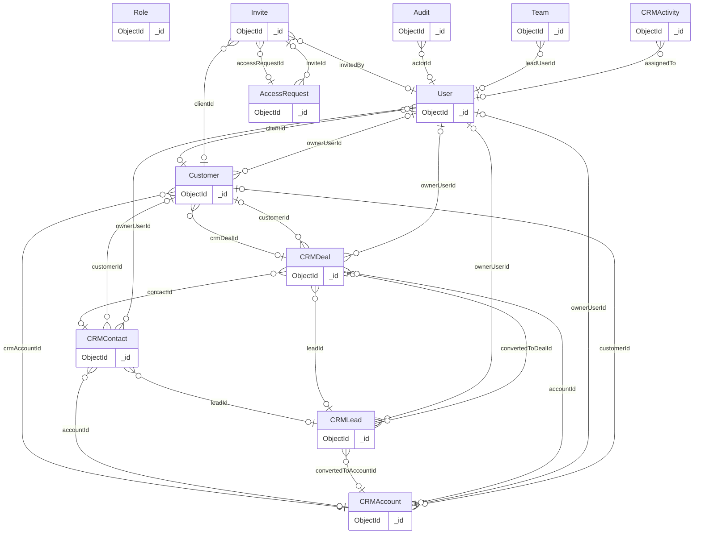
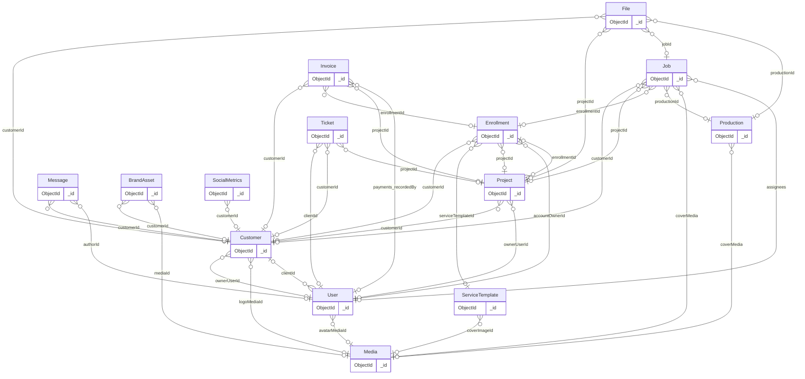
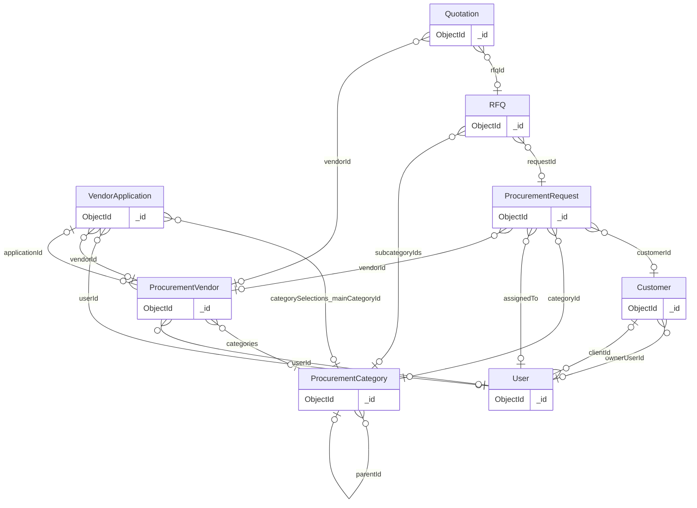
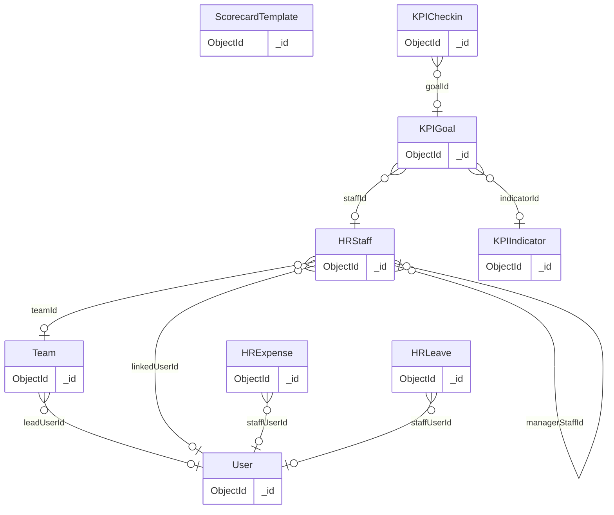
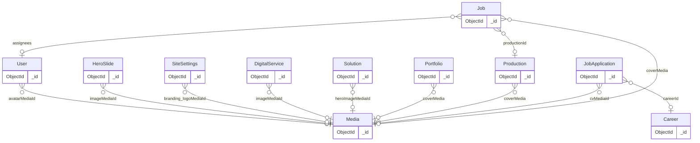

# Database map and reset classification

[Blueprint](EXPRESSO-SYSTEM-BLUEPRINT.html) · [Executive summary](README.md) · Baseline `58b8f86c`.

## What was inspected

Every `*.model.js` definition under `portal-api/src/modules` was parsed: **45 files, 45 distinct registered models, 45 expected collection names** (44 at the audit baseline; R3 added `Counter`). Model getter calls such as `mongoose.model("Ticket")` are not additional model definitions. Embedded schemas are not counted as collections. Collection names below use Mongoose's default pluralizer unless explicitly configured; actual live collection existence/counts were **not queried**.

The source inventory records fields, explicit refs, enums and index declarations for every model. Classification is a **retention recommendation for the model's purpose**, not approval to delete records. No collection is classified TEST/LEGACY merely because sample records might exist. **No confirmed test-only collection was found.**

## Admin

| Model → expected collection | Class | Relationships and reset note | Source |
|---|---|---|---|
| Counter → `counters` | SYSTEM | Refs: none. Added in R3 (P2-3): one document per sequence and year (`invoice-2026`, `rfq-2026`) holding the last issued number. Keep on a business-data reset so invoice and RFQ numbers already sent out are never reused. Safe to lose: a missing counter restarts from the highest number still stored. | [portal-api/src/modules/admin/counter.model.js](../../portal-api/src/modules/admin/counter.model.js) L16 |

## Billing

| Model → expected collection | Class | Relationships and reset note | Source |
|---|---|---|---|
| Invoice → `invoices` | BUSINESS | Refs: Customer, Enrollment, Project, User. Payments/items are embedded; no separate Payment collection or gateway settlement ledger. | [portal-api/src/modules/billing/invoice.model.js](../../portal-api/src/modules/billing/invoice.model.js) L131 |

## Brand Kit

| Model → expected collection | Class | Relationships and reset note | Source |
|---|---|---|---|
| BrandAsset → `brandassets` | BUSINESS | Refs: Customer, Media, User. Operational records; only a future approved reset may remove them after references/retention are resolved. | [portal-api/src/modules/brand-kit/brandAsset.model.js](../../portal-api/src/modules/brand-kit/brandAsset.model.js) L38 |

## Careers

| Model → expected collection | Class | Relationships and reset note | Source |
|---|---|---|---|
| JobApplication → `jobapplications` | BUSINESS | Refs: Career, Media, User. Candidate data and private CV key; retention/privacy decision required before any wipe. | [portal-api/src/modules/careers/application.model.js](../../portal-api/src/modules/careers/application.model.js) L28 |
| Career → `careers` | CMS | Refs: none explicit. Editable public content; preserve approved publication metadata and referenced assets. | [portal-api/src/modules/careers/career.model.js](../../portal-api/src/modules/careers/career.model.js) L18 |

## Content

| Model → expected collection | Class | Relationships and reset note | Source |
|---|---|---|---|
| Job → `jobs` | BUSINESS | Refs: Customer, Enrollment, Media, Production, Project, User. Operational delivery record can also be a published homepage reel; export/preserve curated public subset before a business wipe. | [portal-api/src/modules/content/jobs/job.model.js](../../portal-api/src/modules/content/jobs/job.model.js) L380 |
| Media → `media` | CMS | Refs: User. Shared public asset registry, including CMS and operational references; preserve until object/reference reconciliation. | [portal-api/src/modules/content/media/media.model.js](../../portal-api/src/modules/content/media/media.model.js) L42 |
| Production → `productions` | CMS | Refs: Media. Older showcase content with mounted public API; not confirmed obsolete or test-only. | [portal-api/src/modules/content/productions/production.model.js](../../portal-api/src/modules/content/productions/production.model.js) L54 |
| SocialMetrics → `socialmetrics` | BUSINESS | Refs: Customer, User. Operational records; only a future approved reset may remove them after references/retention are resolved. | [portal-api/src/modules/content/social-metrics/socialMetrics.model.js](../../portal-api/src/modules/content/social-metrics/socialMetrics.model.js) L49 |

## Crm

| Model → expected collection | Class | Relationships and reset note | Source |
|---|---|---|---|
| CRMAccount → `crmaccounts` | BUSINESS | Refs: Customer, User. Operational records; only a future approved reset may remove them after references/retention are resolved. | [portal-api/src/modules/crm/accounts/account.model.js](../../portal-api/src/modules/crm/accounts/account.model.js) L109 |
| CRMActivity → `crmactivities` | BUSINESS | Refs: User. Business sales activity with polymorphic entityId; distinct from security Audit. | [portal-api/src/modules/crm/activities/activity.model.js](../../portal-api/src/modules/crm/activities/activity.model.js) L94 |
| CRMContact → `crmcontacts` | BUSINESS | Refs: CRMAccount, CRMLead, Customer, User. Operational records; only a future approved reset may remove them after references/retention are resolved. | [portal-api/src/modules/crm/contacts/contact.model.js](../../portal-api/src/modules/crm/contacts/contact.model.js) L110 |
| CRMDeal → `crmdeals` | BUSINESS | Refs: CRMAccount, CRMContact, CRMLead, Customer, User. Operational records; only a future approved reset may remove them after references/retention are resolved. | [portal-api/src/modules/crm/deals/deal.model.js](../../portal-api/src/modules/crm/deals/deal.model.js) L144 |
| CRMLead → `crmleads` | BUSINESS | Refs: CRMAccount, CRMDeal, User. Operational records; only a future approved reset may remove them after references/retention are resolved. | [portal-api/src/modules/crm/leads/lead.model.js](../../portal-api/src/modules/crm/leads/lead.model.js) L79 |

## Customers

| Model → expected collection | Class | Relationships and reset note | Source |
|---|---|---|---|
| Customer → `customers` | BUSINESS | Refs: CRMAccount, CRMDeal, Media, User. Operational records; only a future approved reset may remove them after references/retention are resolved. | [portal-api/src/modules/customers/customer.model.js](../../portal-api/src/modules/customers/customer.model.js) L79 |

## Enrollments

| Model → expected collection | Class | Relationships and reset note | Source |
|---|---|---|---|
| Enrollment → `enrollments` | BUSINESS | Refs: Customer, Project, ServiceTemplate, User. Snapshots/overrides/finalScope; references across retained projects/jobs need reconciliation. | [portal-api/src/modules/enrollments/enrollment.model.js](../../portal-api/src/modules/enrollments/enrollment.model.js) L164 |

## Files

| Model → expected collection | Class | Relationships and reset note | Source |
|---|---|---|---|
| File → `files` | BUSINESS | Refs: Customer, Job, Production, Project, User. Operational records; only a future approved reset may remove them after references/retention are resolved. | [portal-api/src/modules/files/file.model.js](../../portal-api/src/modules/files/file.model.js) L127 |

## Homepage

| Model → expected collection | Class | Relationships and reset note | Source |
|---|---|---|---|
| SiteSettings → `sitesettings` | CONFIGURATION | Refs: Media. Singleton `_id: site`; branding/media/settings should survive a business reset. GET can create a blank singleton. | [portal-api/src/modules/homepage/settings.model.js](../../portal-api/src/modules/homepage/settings.model.js) L375 |
| HeroSlide → `heroslides` | CMS | Refs: Media, User. Editable public content; preserve approved publication metadata and referenced assets. | [portal-api/src/modules/homepage/slide.model.js](../../portal-api/src/modules/homepage/slide.model.js) L107 |

## Hr

| Model → expected collection | Class | Relationships and reset note | Source |
|---|---|---|---|
| HRExpense → `hrexpenses` | BUSINESS | Refs: Media, User. Receipt URL/legacy Media reference is not proof of private upload storage. | [portal-api/src/modules/hr/expenses/expense.model.js](../../portal-api/src/modules/hr/expenses/expense.model.js) L190 |
| KPICheckin → `kpicheckins` | BUSINESS | Refs: KPIGoal, User. Operational records; only a future approved reset may remove them after references/retention are resolved. | [portal-api/src/modules/hr/kpi/kpiCheckin.model.js](../../portal-api/src/modules/hr/kpi/kpiCheckin.model.js) L17 |
| KPIGoal → `kpigoals` | BUSINESS | Refs: HRStaff, KPIIndicator, User. Operational records; only a future approved reset may remove them after references/retention are resolved. | [portal-api/src/modules/hr/kpi/kpiGoal.model.js](../../portal-api/src/modules/hr/kpi/kpiGoal.model.js) L49 |
| KPIIndicator → `kpiindicators` | CONFIGURATION | Refs: User. Reusable metric definitions/autoSource; KPI goals/check-ins are separate business data. | [portal-api/src/modules/hr/kpi/kpiIndicator.model.js](../../portal-api/src/modules/hr/kpi/kpiIndicator.model.js) L45 |
| HRLeave → `hrleaves` | BUSINESS | Refs: User. Operational records; only a future approved reset may remove them after references/retention are resolved. | [portal-api/src/modules/hr/leaves/leave.model.js](../../portal-api/src/modules/hr/leaves/leave.model.js) L124 |
| ScorecardTemplate → `scorecardtemplates` | CONFIGURATION | Refs: User. Review defaults; not employee performance history. | [portal-api/src/modules/hr/scorecard-templates/template.model.js](../../portal-api/src/modules/hr/scorecard-templates/template.model.js) L46 |
| HRStaff → `hrstaffs` | BUSINESS | Refs: HRStaff, Team, User. Includes embedded skills, scorecards and learning goals; no separate skills/scorecard collections. | [portal-api/src/modules/hr/staff/staff.model.js](../../portal-api/src/modules/hr/staff/staff.model.js) L219 |

## Iam

| Model → expected collection | Class | Relationships and reset note | Source |
|---|---|---|---|
| AccessRequest → `accessrequests` | BUSINESS | Refs: Invite, User. Operational access applications; personal data, not role configuration. | [portal-api/src/modules/iam/access-requests/accessRequest.model.js](../../portal-api/src/modules/iam/access-requests/accessRequest.model.js) L48 |
| Audit → `audits` | LOG/AUDIT | Refs: User. Historical IAM actions, not full mutation coverage for every business domain. | [portal-api/src/modules/iam/audit/audit.model.js](../../portal-api/src/modules/iam/audit/audit.model.js) L29 |
| Invite → `invites` | BUSINESS | Refs: AccessRequest, Customer, User. Pending onboarding tokens/state, parallel to AccessRequest. A fresh install needs none; never seed or re-use tokens. (Reclassified from SYSTEM in this pass: the invite *mechanism* is system code, its rows are transient operational data.) | [portal-api/src/modules/iam/invites/invite.model.js](../../portal-api/src/modules/iam/invites/invite.model.js) L100 |
| Role → `roles` | SYSTEM | Refs: none explicit. Custom grants/classification; built-in roles have code fallbacks but custom roles do not. | [portal-api/src/modules/iam/roles/role.model.js](../../portal-api/src/modules/iam/roles/role.model.js) L52 |
| Team → `teams` | CONFIGURATION | Refs: User. Business reference configuration; staff may reference its ID and users its key. | [portal-api/src/modules/iam/teams/team.model.js](../../portal-api/src/modules/iam/teams/team.model.js) L42 |
| User → `users` | SYSTEM | Refs: Customer, Media. Account identity, password/token hashes and company linkage. Preserve IDs for retained records. | [portal-api/src/modules/iam/users/user.model.js](../../portal-api/src/modules/iam/users/user.model.js) L87 |

## Messaging

| Model → expected collection | Class | Relationships and reset note | Source |
|---|---|---|---|
| Message → `messages` | BUSINESS | Refs: Customer, User. Business conversation/read state; not a disposable application log. | [portal-api/src/modules/messaging/message.model.js](../../portal-api/src/modules/messaging/message.model.js) L27 |

## Portfolio

| Model → expected collection | Class | Relationships and reset note | Source |
|---|---|---|---|
| Portfolio → `portfolios` | CMS | Refs: Media. Editable public content; preserve approved publication metadata and referenced assets. | [portal-api/src/modules/portfolio/portfolio.model.js](../../portal-api/src/modules/portfolio/portfolio.model.js) L75 |

## Procurement

| Model → expected collection | Class | Relationships and reset note | Source |
|---|---|---|---|
| ProcurementCategory → `procurementcategories` | CONFIGURATION | Refs: Media, ProcurementCategory. Required three-level reference tree for vendor selections/matching. Parent and child IDs matter. | [portal-api/src/modules/procurement/category.model.js](../../portal-api/src/modules/procurement/category.model.js) L47 |
| Quotation → `quotations` | BUSINESS | Refs: ProcurementVendor, RFQ. Operational records; only a future approved reset may remove them after references/retention are resolved. | [portal-api/src/modules/procurement/quotation.model.js](../../portal-api/src/modules/procurement/quotation.model.js) L34 |
| ProcurementRequest → `procurementrequests` | BUSINESS | Refs: Customer, ProcurementCategory, ProcurementVendor, User. Operational records; only a future approved reset may remove them after references/retention are resolved. | [portal-api/src/modules/procurement/request.model.js](../../portal-api/src/modules/procurement/request.model.js) L69 |
| RFQ → `rfqs` | BUSINESS | Refs: ProcurementCategory, ProcurementRequest, User. Operational records; only a future approved reset may remove them after references/retention are resolved. | [portal-api/src/modules/procurement/rfq.model.js](../../portal-api/src/modules/procurement/rfq.model.js) L39 |
| VendorApplication → `vendorapplications` | BUSINESS | Refs: ProcurementCategory, ProcurementVendor, User. Operational records; only a future approved reset may remove them after references/retention are resolved. | [portal-api/src/modules/procurement/vendor-application.model.js](../../portal-api/src/modules/procurement/vendor-application.model.js) L52 |
| ProcurementVendor → `procurementvendors` | BUSINESS | Refs: ProcurementCategory, User, VendorApplication. Operational records; only a future approved reset may remove them after references/retention are resolved. | [portal-api/src/modules/procurement/vendor.model.js](../../portal-api/src/modules/procurement/vendor.model.js) L24 |

## Projects

| Model → expected collection | Class | Relationships and reset note | Source |
|---|---|---|---|
| Project → `projects` | BUSINESS | Refs: Customer, Enrollment, User. Operational records; only a future approved reset may remove them after references/retention are resolved. | [portal-api/src/modules/projects/project.model.js](../../portal-api/src/modules/projects/project.model.js) L138 |

## Services

| Model → expected collection | Class | Relationships and reset note | Source |
|---|---|---|---|
| ServiceTemplate → `servicetemplates` | CONFIGURATION | Refs: Media, User. Approved commercial catalog/scope/SLA and private attachments; preserve independently of client enrollments. | [portal-api/src/modules/services/serviceTemplate.model.js](../../portal-api/src/modules/services/serviceTemplate.model.js) L194 |

## Tickets

| Model → expected collection | Class | Relationships and reset note | Source |
|---|---|---|---|
| Ticket → `tickets` | BUSINESS | Refs: Customer, Project, User. Legacy clientId references User; customerId references Customer. Comments/attachments/approval state are embedded. | [portal-api/src/modules/tickets/ticket.model.js](../../portal-api/src/modules/tickets/ticket.model.js) L139 |

## Web Content

| Model → expected collection | Class | Relationships and reset note | Source |
|---|---|---|---|
| DigitalService → `digitalservices` | CMS | Refs: Media, User. Editable public content; preserve approved publication metadata and referenced assets. | [portal-api/src/modules/web-content/digitalService.model.js](../../portal-api/src/modules/web-content/digitalService.model.js) L38 |
| Solution → `solutions` | CMS | Refs: Media, User. Editable public content; preserve approved publication metadata and referenced assets. | [portal-api/src/modules/web-content/solution.model.js](../../portal-api/src/modules/web-content/solution.model.js) L47 |

## Classification totals

**BUSINESS: 28**, **CMS: 7**, **CONFIGURATION: 6**, **LOG/AUDIT: 1**, **SYSTEM: 3** (User, Role, Counter). TEST/LEGACY: **0 confirmed** — test records are rows inside real collections, not separate collections.

## ER diagrams

These diagrams show the principal relationships by domain. Cardinality is conceptual: MongoDB references are not foreign-key constraints, and many IDs are nullable. Repeated creator/updater User edges are omitted for readability; the complete explicit-reference inventory follows the diagrams. Logical string/polymorphic relationships are described separately.

### Identity and company hub

### Commercial delivery and finance

### Procurement

### HR

### Public publishing

### Relationships not expressible as one simple ref

- `User.role` joins `Role.key` as a string; missing built-in role documents fall back to code permissions.
- `User.team` is a string/key; `HRStaff.teamId` is an ObjectId reference to Team.
- `CRMActivity.entityType + entityId` links a lead/deal/account/contact/customer without a Mongoose refPath.
- `Audit.action/meta` are generic event metadata, not enforced business foreign keys.
- `Ticket.clientId` refers to User; most other `clientId` fields refer to Customer. Never equate them during a reset.
- Invoice payments/items, Ticket comments, HRStaff scorecards/skills/goals, Enrollment scope snapshots, ServiceTemplate groups/files and RFQ/Quotation attachments are embedded data, not extra collections.
- Some URLs refer directly to storage without a Media/File ref. Database-only dependency traversal cannot discover every object.
- No separate models were found for payment gateways, payroll, purchase orders, stock/inventory, a general Notification queue, a database-backed permission catalog or the CAS operating system itself. The CAS website page describes a product; it is not the CAS clinical database.

## Complete explicit ref inventory

Actor refs are included here even when omitted from diagrams. The machine-readable inventory adds field types, enums and source lines.

| Child model | Ref paths → target models |
|---|---|
| Invoice | `customerId` → Customer; `enrollmentId` → Enrollment; `projectId` → Project; `payments[].recordedBy` → User; `createdBy` → User; `updatedBy` → User |
| BrandAsset | `customerId` → Customer; `mediaId` → Media; `createdBy` → User |
| JobApplication | `careerId` → Career; `cvMediaId` → Media; `reviewedBy` → User |
| Career | No explicit ref; see logical relationships above. |
| Job | `customerId` → Customer; `projectId` → Project; `enrollmentId` → Enrollment; `productionId` → Production; `coverMedia` → Media; `draftMediaId` → Media; `finalMediaId` → Media; `posterMediaId` → Media; `media` → Media; `assignees` → User; `approvals[].createdBy` → User; `createdBy` → User; `updatedBy` → User |
| Media | `createdBy` → User |
| Production | `coverMedia` → Media; `gallery` → Media |
| SocialMetrics | `customerId` → Customer; `createdBy` → User; `updatedBy` → User |
| CRMAccount | `ownerUserId` → User; `customerId` → Customer; `createdBy` → User; `updatedBy` → User |
| CRMActivity | `assignedTo` → User; `createdBy` → User; `updatedBy` → User |
| CRMContact | `accountId` → CRMAccount; `customerId` → Customer; `leadId` → CRMLead; `ownerUserId` → User; `createdBy` → User; `updatedBy` → User |
| CRMDeal | `accountId` → CRMAccount; `contactId` → CRMContact; `leadId` → CRMLead; `customerId` → Customer; `ownerUserId` → User; `createdBy` → User; `updatedBy` → User |
| CRMLead | `ownerUserId` → User; `convertedToAccountId` → CRMAccount; `convertedToDealId` → CRMDeal; `createdBy` → User; `updatedBy` → User; `convertedDealId` → CRMDeal |
| Customer | `ownerUserId` → User; `logoMediaId` → Media; `crmAccountId` → CRMAccount; `crmDealId` → CRMDeal; `createdBy` → User; `updatedBy` → User |
| Enrollment | `customerId` → Customer; `serviceTemplateId` → ServiceTemplate; `projectId` → Project; `accountOwnerId` → User; `executionLeadId` → User; `createdBy` → User; `updatedBy` → User |
| File | `customerId` → Customer; `projectId` → Project; `jobId` → Job; `productionId` → Production; `createdBy` → User; `updatedBy` → User |
| SiteSettings | `branding.logoMediaId` → Media; `branding.logoWhiteMediaId` → Media; `branding.faviconMediaId` → Media; `branding.ogImageMediaId` → Media; `home.heroBannerMediaId` → Media; `homepageSections.aboutImageMediaId` → Media; `homepageSections.servicesImageMediaId` → Media; `about.heroImageMediaId` → Media; `about.teamPhotoMediaId` → Media; `about.missionImageMediaId` → Media; `about.missionDeviceImageMediaId` → Media; `about.blueprintCustomerImageMediaId` → Media; `about.blueprintInnovationImageMediaId` → Media; `about.blueprintQualityImageMediaId` → Media; `about.teamMohamedImageMediaId` → Media; `about.teamHassanImageMediaId` → Media; `about.teamSwekshyaImageMediaId` → Media; `about.teamAfridImageMediaId` → Media; `about.teamNazimImageMediaId` → Media; `about.teamSaadImageMediaId` → Media; `about.teamYasirImageMediaId` → Media; `services.heroImageMediaId` → Media; `services.sectionBgMediaId` → Media; `portfolio.heroImageMediaId` → Media; `careers.heroImageMediaId` → Media; `careers.officeImageMediaId` → Media; `contact.heroImageMediaId` → Media; `contact.officeImageMediaId` → Media; `websiteImages.images[].mediaId` → Media; `gallery.images[].mediaId` → Media; `itSolutions.heroImageMediaId` → Media; `itSolutions.softwareLicensingHeroImageMediaId` → Media; `itSolutions.erpSolutionHeroImageMediaId` → Media; `itSolutions.crmSolutionHeroImageMediaId` → Media; `itSolutions.queueManagementHeroImageMediaId` → Media; `itSolutions.iotSolutionsHeroImageMediaId` → Media; `itSolutions.vasSolutionsHeroImageMediaId` → Media; `itSolutions.cloudServicesHeroImageMediaId` → Media; `itSolutions.webHostingDomainsHeroImageMediaId` → Media; `itSolutions.dataCenterHeroImageMediaId` → Media; `itSolutions.itConsultationHeroImageMediaId` → Media; `itSolutions.networkingHardwareHeroImageMediaId` → Media; `itSolutions.dataCenterHardwareHeroImageMediaId` → Media; `marquee.brands[].mediaId` → Media |
| HeroSlide | `imageMediaId` → Media; `thumbImageMediaId` → Media; `createdBy` → User; `updatedBy` → User |
| HRExpense | `staffUserId` → User; `receiptMediaId` → Media; `approvedBy` → User; `registeredBy` → User; `createdBy` → User; `updatedBy` → User |
| KPICheckin | `goalId` → KPIGoal; `createdBy` → User |
| KPIGoal | `indicatorId` → KPIIndicator; `staffId` → HRStaff; `createdBy` → User; `updatedBy` → User |
| KPIIndicator | `createdBy` → User; `updatedBy` → User |
| HRLeave | `staffUserId` → User; `approvedBy` → User; `createdBy` → User; `updatedBy` → User |
| ScorecardTemplate | `createdBy` → User; `updatedBy` → User |
| HRStaff | `linkedUserId` → User; `managerStaffId` → HRStaff; `teamId` → Team; `createdBy` → User; `updatedBy` → User |
| AccessRequest | `reviewedBy` → User; `inviteId` → Invite |
| Audit | `actorId` → User; `targetUserId` → User |
| Invite | `invitedBy` → User; `clientId` → Customer; `accessRequestId` → AccessRequest; `acceptedByUserId` → User |
| Role | No explicit ref; see logical relationships above. |
| Team | `leadUserId` → User |
| User | `avatarMediaId` → Media; `clientId` → Customer |
| Message | `customerId` → Customer; `authorId` → User; `readBy` → User |
| Portfolio | `coverMedia` → Media; `gallery` → Media |
| ProcurementCategory | `parentId` → ProcurementCategory; `heroImageMediaId` → Media |
| Quotation | `rfqId` → RFQ; `vendorId` → ProcurementVendor |
| ProcurementRequest | `customerId` → Customer; `categoryId` → ProcurementCategory; `assignedTo` → User; `vendorId` → ProcurementVendor; `createdBy` → User; `updatedBy` → User |
| RFQ | `requestId` → ProcurementRequest; `subcategoryIds` → ProcurementCategory; `createdBy` → User |
| VendorApplication | `categorySelections[].mainCategoryId` → ProcurementCategory; `categorySelections[].categoryId` → ProcurementCategory; `categorySelections[].subcategoryId` → ProcurementCategory; `approvedBy` → User; `userId` → User; `vendorId` → ProcurementVendor |
| ProcurementVendor | `categories` → ProcurementCategory; `applicationId` → VendorApplication; `userId` → User |
| Project | `customerId` → Customer; `enrollmentId` → Enrollment; `ownerUserId` → User; `createdBy` → User; `updatedBy` → User |
| ServiceTemplate | `coverImageId` → Media; `files.mediaRefs` → Media; `createdBy` → User; `updatedBy` → User |
| Ticket | `clientId` → User; `customerId` → Customer; `projectId` → Project; `assigneeId` → User; `watcherIds` → User; `approvedBy` → User; `comments[].authorId` → User |
| DigitalService | `imageMediaId` → Media; `heroImageMediaId` → Media; `createdBy` → User; `updatedBy` → User |
| Solution | `heroImageMediaId` → Media; `createdBy` → User; `updatedBy` → User |

## Reset constraints

SYSTEM/CONFIGURATION/CMS records normally survive a business-data reset. BUSINESS is **potentially resettable**, not automatically safe: finance/HR/candidate/conversation retention and shared published Job/media links require owner decisions. LOG/AUDIT should have its own retention policy, not be silently erased. See [reset plan](DATABASE-RESET-PLAN.md).
