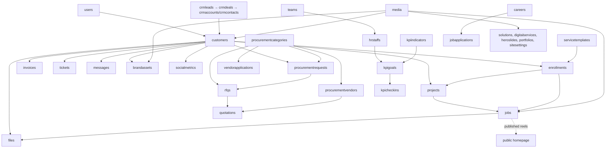
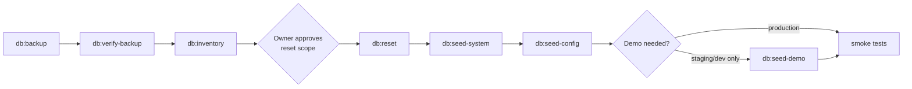

# Database reset plan — proposal only

**Blueprint closure:** D1–D3 are CLOSED foundations; D4 seed and D5 reset are DEFERRED post-Blueprint. No reset/seed operation is authorized. See [final code closure and deployment acceptance](BLUEPRINT-CLOSURE.md).

[Blueprint](EXPRESSO-SYSTEM-BLUEPRINT.html) · [Database map](DATABASE-MAP.md) · Baseline `58b8f86c`.

> **No reset has been performed.** This audit did not connect to any database, read any `.env` value, or run any seed or script. Nothing here is approved to run. It describes what a clean Expresso installation needs, and a controlled lifecycle to build later.
>
> **R5-D1 (complete / committed):** the read-only lifecycle safety foundation exists — target identity checks, a versioned manifest model with offline validation, a read-only inventory, catalog/protection metadata and an append-only evidence format ([runbook](../../portal-api/docs/lifecycle.md)). It provides **no** backup, restore, reset or seed. D2 backup and D3 restore verification are now CLOSED local/disposable foundations; D4/D5 remain DEFERRED. This D1 paragraph records the original foundation boundary.

## 1. What a fresh installation actually needs

The API **starts against an empty database**. `server.js` validates the environment, connects to MongoDB and starts listening. It does **not** create users, roles, settings or content. Mongoose creates collections and indexes when they are first used.

| Layer | Where it lives | Survives an empty database? | What must be recreated |
|---|---|---|---|
| Permission keys (78) and built-in role defaults (14) | Code: `portal-api/src/config/permissions.js` | **Yes.** `GET /api/roles` lists built-in roles even without Role documents, and permissions resolve from code | Nothing, unless you want built-in roles stored as editable Role documents (`seedRoles.js`) |
| Environment | `portal-api/.env`, client `.env` | Yes (outside MongoDB) | Names only: `MONGO_URI`, `JWT_SECRET` (**required — the API refuses to start without it**), `JWT_EXPIRES_IN`, `FRONTEND_URL`, `SUPER_ADMIN_*`, `SMTP_*`, `AWS_*`/bucket names, `GOOGLE_CLIENT_ID`, `DB_ENVIRONMENT`; client `REACT_APP_API_URL`, `REACT_APP_EMAILJS_*`, `REACT_APP_GOOGLE_CLIENT_ID` |
| Website code defaults | Client code: copy, pricing, CAS page, core product registry, technology group fallback, brand assets | Yes | Nothing — but see the CMS row |
| Uploaded files | S3 buckets or `uploads` / `private-uploads` folders | Yes (separate from MongoDB) | References to them **are** lost — see section 5 |
| Everything else | MongoDB | **No** | See the table below |

### Required baseline after a clean database

| Order | What | Why it is required | How today | Class |
|---|---|---|---|---|
| 1 | **First super admin** (User, role `super_admin`) | Nobody can sign in otherwise. There is no signup and no automatic bootstrap | `npm run seed` → `seedUser.js`, using `SUPER_ADMIN_EMAIL`, `SUPER_ADMIN_PASSWORD`, `SUPER_ADMIN_NAME` | SYSTEM |
| 2 | **Role documents** for the 14 built-ins | Optional but recommended: makes built-in roles visible and editable as stored records, and fixes internal/external classification | `seedRoles.js` (upsert by key) | SYSTEM |
| 3 | **Custom roles** that existed before | Code defaults do **not** recreate custom roles; users assigned to them would get no permissions | Export/import of the `roles` collection (no script exists) | SYSTEM |
| 4 | **Procurement category tree** (3 levels) | Vendor registration and RFQ vendor matching use category ObjectIds; with no tree the public form cannot be completed | `seedProcurementCategories.js` (insert-if-missing by code) | CONFIGURATION |
| 5 | **Site settings** singleton `_id: "site"` | Optional: reads never create it (R4-B, P2-6). Until the first admin save, both reads return the model defaults without writing anything, and the site falls back to code images | Export/import, or edit again in the portal | CONFIGURATION |
| 6 | **Teams** | Needed if invites name a team (an invite with an inactive or missing team is refused), and for HR staff `teamId` | Recreate in `/portal/teams` or import | CONFIGURATION |
| 7 | **Service templates** (internal catalog) | Needed before any client enrollment can be created | Recreate in `/portal/services` or import (no seed) | CONFIGURATION |
| 8 | **KPI indicators / scorecard templates** | Needed for HR KPI goals and scorecards | Recreate or import. **Do not use `seedHRKPI.js`** — it also creates demo staff, goals and check-ins | CONFIGURATION |
| 9 | **Technology Solutions** (12 records) | `/it-solutions` and its 12 sitemap URLs show nothing without them | `seedWebContent.js` (inserts only into an empty collection), or export/import approved records | CMS |
| 10 | **Digital Services** (6 records) | `/services` cards and the 6 `/service/:slug` sitemap URLs are empty without them | `seedWebContent.js`, or export/import | CMS |
| 11 | **CAS Digital Solution record** | Optional: CAS is discoverable from code. A record only enriches its card | `seedDigitalSolutions.js` (insert-only) | CMS |
| 12 | **Portfolio, hero slides, careers, Media** | Public galleries, case studies, home slider and vacancies are empty without them | Export/import approved content; `seedPortfolio.js` exists, but its content must be confirmed as approved | CMS |

## 2. Classification of all 45 collections

From the [database map](DATABASE-MAP.md). **No collection is test-only by design** — test records are *rows* inside real business collections.

| Class | Count | Collections | Fresh install | Business-data reset |
|---|---:|---|---|---|
| SYSTEM | 3 | `users`, `roles`, `counters` | Create super admin; optionally seed roles; `counters` starts empty and fills itself | **Keep** (except chosen test users — see below). Keep `counters` so issued invoice and RFQ numbers are never reused |
| CONFIGURATION | 6 | `sitesettings`, `teams`, `servicetemplates`, `procurementcategories`, `scorecardtemplates`, `kpiindicators` | Seed or import approved set | **Keep** |
| CMS | 8 | `solutions`, `digitalservices`, `heroslides`, `portfolios`, `workitems`, `careers`, `media`, `productions` | Import approved content | **Keep** (prune drafts deliberately) |
| LOG/AUDIT | 1 | `audits` | Empty | Retain per a retention policy; never silently erase |
| BUSINESS | 29 | `customers`, `crmleads`, `crmaccounts`, `crmcontacts`, `crmdeals`, `crmactivities`, `enrollments`, `deliveryperiods`, `projects`, `jobs`, `files`, `invoices`, `tickets`, `messages`, `brandassets`, `socialmetrics`, `hrstaffs`, `hrexpenses`, `hrleaves`, `kpigoals`, `kpicheckins`, `procurementrequests`, `rfqs`, `quotations`, `procurementvendors`, `vendorapplications`, `jobapplications`, `accessrequests`, `invites` | Empty | **Candidates** — owner decision per collection |

`invites` is classified BUSINESS (pending onboarding records). A fresh installation needs none, and preserved invitation tokens should never be reused.

### Within SYSTEM: users

Users are not all equal. In a business reset:
- **Keep:** Expresso staff accounts and the super admin.
- **Decide:** client logins (`clientId` → Customer) and vendor logins (linked to ProcurementVendor). If their companies are reset, these accounts are orphaned and should go too.
- **Remove:** test accounts, identified by an agreed list of emails — not by guessing from names.

## 3. Dependency order — what breaks what

MongoDB references are not enforced: deleting a parent leaves children pointing at nothing. Delete children before parents, and keep anything a kept record references.

Safe deletion order for a full business reset (children first):
`quotations → rfqs → procurementrequests → vendorapplications/procurementvendors (+ vendor users) → kpicheckins → kpigoals → hrleaves/hrexpenses → hrstaffs → jobapplications → files → jobs → invoices → tickets → messages → brandassets → socialmetrics → projects → enrollments → crmactivities → crmdeals → crmcontacts → crmaccounts → crmleads → customers (+ client users) → accessrequests/invites`.

Special cases:
- **Jobs published as homepage reels** are business records *and* public content. Export or re-create the reels you want before deleting jobs.
- **Media** is shared by CMS and business records. Do not bulk-delete it. Delete only Media not referenced by any kept record, and delete the S3 object at the same time.
- **Files and CVs** point at private storage keys. Deleting the record does not delete the object (and vice versa).
- **Audit** refers to users by ID; deleting users leaves audit entries whose actor no longer exists. That is acceptable for an audit trail but should be a conscious choice.

## 4. Telling test data from real data

The system has no `isTest` flag. Before any reset, produce an inventory (read-only) of each BUSINESS collection with counts, newest/oldest dates and obvious markers:
- seed markers already in code: notes starting `Seeded by HR KPI expert dataset`, `Seeded expert KPI check-in`, `Expert HR KPI demo profile` (from `seedHRKPI.js`);
- email domains such as `example.com` or agreed test domains;
- records created before the agreed go-live date.

Treat the result as a list for the owner to approve, not as an automatic filter. A real invoice with fake amounts is still an Invoice row; only the owner can say whether it is disposable.

## 5. Storage must be handled with the database

| Store | What MongoDB holds | Risk if only the database is reset |
|---|---|---|
| Public S3 / `uploads` | Media URLs and keys, image variants | Objects remain publicly reachable by URL; storage fills with orphans |
| Private S3 / `private-uploads` | File keys, CV keys, template attachments | Confidential objects remain with no owner record; nobody can find them to delete |
| Hard-coded `/public` assets | Some CMS records store `/images/...` paths | Pruning `client/public` can break CMS records (see cleanup item R4) |

Any future reset needs a matching storage step: list objects, match them to surviving references, and delete or archive the rest.

## 6. Proposed future lifecycle (R5-D1 foundation only; the rest not implemented)

| Command | Purpose | Guard rails |
|---|---|---|
| `db:backup` | Full `mongodump` (or Atlas snapshot) **plus** an object listing of both buckets | Writes outside the repository; never prints connection strings |
| `db:verify-backup` | Restore into a disposable local database and compare counts | Must pass before any reset may run |
| `db:inventory` | Read-only counts, dates and test markers per collection (section 4) | `assertSafeTarget({ readOnly: true })` |
| `db:reset` | Delete **only** the approved BUSINESS collections or rows, in the order in section 3 | Refuses production unless `--allow-production`; dry run by default; requires a backup ID |
| `db:seed-system` | First super admin + built-in Role documents | Idempotent; **must not overwrite** an existing user's password (unlike `seedUser.js` today, F12) |
| `db:seed-config` | Procurement categories; optional approved teams, service templates, KPI indicators, scorecard templates from versioned JSON | Insert-if-missing by stable key |
| `db:seed-cms` | Approved website content (Solutions, Digital Services, CAS record, portfolio) from versioned JSON | Insert-if-missing; never overwrite portal edits |
| `db:seed-demo` | Demo customers, projects, invoices, HR KPI data | **Never on production**; every row tagged `demo: true` so it can be removed later |

All of these should reuse the existing `_guard.js` (local by default; staging must be declared; production refused unless explicitly allowed).

**Update (R5-D1).** The lifecycle commands use their own, stricter target check instead of `_guard.js` (which is unchanged and still guards the existing seeds): a declared profile must match the observed connection identity exactly, `localhost`, `DB_ENVIRONMENT` and database names are never trusted alone, and there is no production override. Of the commands above only a read-only `db:inventory` exists (catalog-only, or against a captured snapshot; no live database connection), plus `db:manifest-check` for the future backup manifest. `db:verify-backup`, `db:reset` and the `db:seed-*` commands do not exist; they are R5-D3–D5. **Update (R5-D2, complete / committed):** `db:backup` now exists for local/disposable targets only: a database-only `mongodump` archive with a sealed manifest, checksums and evidence, never a restore (see [backup runbook](../../portal-api/docs/backup.md)); object-storage listing is not part of it. **Update (R5-D3, complete / committed / pushed):** `db:restore-verify` restores ONE verified D2 artifact into a new, empty verification database on a separate local/disposable replica set (never the source database or server, no `--drop`, exact namespace remapping) and compares it with the manifest; it is verification, not an operator restore, and has no drop or clean-up capability (see [restore-verification runbook](../../portal-api/docs/restore-verify.md)). `db:reset` and the `db:seed-*` commands still do not exist (R5-D4–D5). In the R5-D1 catalog every collection is protected and none is reset-eligible; section 8 remains a proposal for the owner, not a policy.

## 7. What would break if MongoDB were emptied today

- **Nobody can sign in.** No users exist, and creating the first one needs `seedUser.js` run by someone with server access.
- **Every client, vendor and staff relationship is gone:** companies, projects, invoices, tickets, messages, HR records, procurement history.
- **Custom roles disappear;** built-in roles keep working from code.
- **Vendor registration cannot be completed** until the category tree is reseeded.
- **Public site:** `/it-solutions` shows its empty state and its 12 detail URLs return Not Found; `/services` has no cards and its 6 detail URLs fail; portfolio, case studies, home slider, reels and careers are empty. CAS, navigation, static pages and pricing still render from code. The site settings singleton is recreated **blank** on the first visit.
- **Uploaded files survive in storage** but lose every record that pointed at them.

## 8. What appears safe to reset later (subject to owner approval)

- **Safe after backup and approval:** demo/test rows inside BUSINESS collections; data created by `seedHRKPI.js`; expired or used `invites`; handled `accessrequests`; test client and vendor accounts with their companies.
- **Safe only with a retention decision:** `invoices`, `hrexpenses`, `hrleaves`, `hrstaffs` (financial and employment records); `jobapplications` (candidate personal data); `messages`, `tickets`; `audits`.
- **Not reset in a business reset:** `users` (staff), `roles`, all CONFIGURATION and CMS collections, and the matching storage objects.
