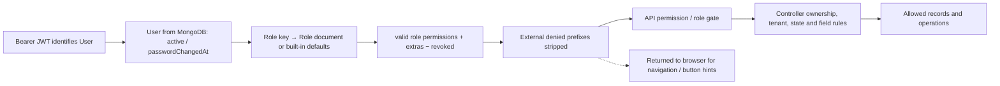

# RBAC map

[Blueprint](EXPRESSO-SYSTEM-BLUEPRINT.html) · [Executive summary](README.md) · Baseline `58b8f86c`.

## Authority and effective access

Sources: [auth middleware](../../portal-api/src/middleware/auth.js), [role registry](../../portal-api/src/utils/roleRegistry.js), [access control](../../portal-api/src/utils/accessControl.js), [HR ownership](../../portal-api/src/utils/ownership.js).

- `requireAuth` verifies the JWT, reloads User by ID, rejects inactive/deleted users and tokens older than passwordChangedAt, and resolves current DB/code permissions. The JWT's role is not the API authority.
- Built-in `super_admin` bypasses permission gates. Its effective API permission array is empty by design; middleware recognizes the role. Other built-ins use DB Role permissions if the filtered array is nonempty, otherwise code defaults.
- Per-user `extraPermissions` add valid keys; `revokedPermissions` remove them. User schema has no active legacy `permissions` field even though a legacy bootstrap payload still supplies it.
- Internal/external classification comes from Role.isInternal, falling back to nine internal system role keys; unknown/custom roles default external unless explicitly classified. Four client roles plus vendor are external by default.
- Externals lose internal-only prefixes including CRM/HR/IAM/website/media/catalog/enrollments/portfolio/production/jobs/social and sensitive billing/customer/procurement mutations. Remaining privileges still require tenant scoping.
- Frontend localStorage contains token/user/permission hints; ProtectedRoute decodes the token and checks route prefixes. It does not replace JWT verification or server authorization. Axios clears expired sessions on protected 401s.

## Source-confirmed mismatches and remaining concerns

| Priority / issue | Evidence | Consequence and recommended follow-up |
|---|---|---|
| High: project create, update and delete, and ticket delete, do not enforce the company boundary used by reads | `projects/project.controller.js`: `createProject`, `updateProject` (can reassign `customerId`), `archiveProject` (a hard delete); `tickets/ticket.controller.js:deleteTicket`; `projects.write`, `projects.delete` and `tickets.delete` are not externally stripped | An external custom role granted these keys could create, edit, move or delete another company's projects, or delete its tickets. Conditional delegated-permission risk; default client roles do not hold them. Remediation P0-2 |
| High: invite tokens in production request logs | `middleware/requestLogger.js` uses morgan `combined`; `GET /api/invites/verify?token=…` | Anyone with log access during an invite's validity could accept it. Remediation P0-4 |
| High: vendor RFQ read contract is inconsistent | RFQ read routes requireInternalUser; controller, VendorDashboard and RFQDetailsPage contain vendor branches; UI denylist blocks externals | Vendor onboarding/login exists, but matching/reading/responding is not a complete usable browser journey. Keep security strict until intended policy is approved. |
| High: public publication boundary | Public Portfolio/Production GETs do not restrict status; web-content accepts includeInactive and detail finds inactive records | Unpublished marketing content is not protected by UI permission gates. Separate public publication projection from CMS management. |
| 74 API keys versus 66 static UI keys | RoleEditor imports frontend catalog; AccessTab imports frontend defaults | Eight valid API permissions cannot be managed correctly by these static pickers; role permission previews can disagree with DB overrides. |
| Frontend role *defaults* drift beyond the 8 missing keys | Client `DEFAULT_ROLE_PERMISSIONS` omits `iam.users.read` for `project_manager` and `staff`, although that key exists in the client catalog (the other differences per role are only the 8 missing keys) | AccessTab previews of a user's role defaults are wrong for these roles. Effective access is unaffected because the API resolves permissions |
| Role documents with an empty permission list fall back to defaults | `resolveRoleContext` and `normalizeRolePermissions` | Built-in role cannot be disabled by clearing its permissions; effective least-privilege outcome can be surprising. Define explicit configured-empty semantics before changing it. |
| Custom role capability versus role-name hierarchy | User/invite controllers canManageRole only allows super_admin/admin; roles controller protects system keys and disallows beyond-actor grants | An internal custom role with iam.users.write or iam.invites.send may pass middleware but fail the controller. Document or consolidate the intended hierarchy. |
| Frontend admin always passes route gate | `ProtectedRoute.jsx:isAllowed` | UI may show routes/actions even when API permissions or DB role overrides deny them. This is a UI/API mismatch, not an API bypass. |
| KPI route gate falls through to hr.staff.read | ProtectedRoute has no hr.kpi-specific entry before broad /portal/hr; API uses hr.kpi.read/write | A KPI-only user can be denied the UI despite API rights, or admitted to the view but denied its requests. |
| Productions UI permission differs from data API | /portal/productions uses productions.read, workspace uses /jobs | Custom least-privilege roles may open an unusable page; default roles often contain both permissions and mask the problem. |
| Many write/delete buttons lack matching permission visibility checks | Pages call mutation APIs; shared Can is currently not in the import graph | Read-only users can see actions that later get 403. Keep API enforcement and add a coherent UI capability source later. |
| User self-delete guard uses the wrong identity property | `deleteUser` compares req.user._id; middleware sets req.user.id | Source-confirmed lockout risk for an authorized super admin; no last-admin safeguard found. Also fix the missing customer model import before exercising deletion. |
| Browser permissions can be stale | ProtectedRoute reads cached values; usePortalPermissions memoizes storage once; JWT role can outlive a DB role change | API remains authoritative; refresh/propagation should become explicit rather than relying on separate caches. |
| Full request URL logging | Morgan combined/dev and local signed-file/invite-verify URLs | Review token redaction and log retention. No live tokens or logs were inspected or included. |

Existing protections worth keeping: beyond-actor grant checks, external permission stripping, internal/own-client filters, HR owner scoping and no-self-approval, private signed downloads, inactive-user checks, password-change revocation, auth rate limits and Google ID-token verification. Their presence is not a full security certification.

## Catalog inventory

Counts below are **literal source references**, excluding catalog definitions, tests and seed scripts. Zero does not prove a permission is unused under every dynamic code path. The API map distinguishes public reads from private management. Complete source lines are in source-inventory.json.

| Permission | API references | UI references | Notes |
|---|---:|---:|---|
| `customers.read` | 3 | 2 | Customers |
| `customers.write` | 5 | 0 | No literal UI use outside catalog |
| `customers.delete` | 2 | 0 | No literal UI use outside catalog |
| `projects.read` | 3 | 5 | Projects |
| `projects.write` | 2 | 0 | No literal UI use outside catalog |
| `projects.delete` | 1 | 0 | No literal UI use outside catalog |
| `productions.read` | 0 | 2 | No literal API enforcement/use found |
| `productions.write` | 3 | 0 | No literal UI use outside catalog |
| `productions.delete` | 1 | 0 | No literal UI use outside catalog |
| `jobs.read` | 2 | 5 | Jobs |
| `jobs.write` | 8 | 0 | No literal UI use outside catalog |
| `jobs.delete` | 2 | 0 | No literal UI use outside catalog |
| `social.metrics.read` | 1 | 0 | Missing from static UI catalog; No literal UI use outside catalog |
| `social.metrics.write` | 2 | 0 | Missing from static UI catalog; No literal UI use outside catalog |
| `media.read` | 1 | 3 | Media Library |
| `media.write` | 2 | 0 | No literal UI use outside catalog |
| `media.delete` | 1 | 0 | No literal UI use outside catalog |
| `files.read` | 4 | 2 | Files |
| `files.write` | 2 | 0 | No literal UI use outside catalog |
| `files.delete` | 1 | 0 | No literal UI use outside catalog |
| `portfolio.read` | 0 | 4 | No literal API enforcement/use found |
| `portfolio.write` | 2 | 0 | No literal UI use outside catalog |
| `portfolio.delete` | 1 | 0 | No literal UI use outside catalog |
| `services.read` | 3 | 3 | Services |
| `services.write` | 3 | 0 | No literal UI use outside catalog |
| `services.delete` | 1 | 0 | No literal UI use outside catalog |
| `enrollments.read` | 2 | 4 | Enrollments |
| `enrollments.write` | 2 | 0 | No literal UI use outside catalog |
| `enrollments.delete` | 1 | 0 | No literal UI use outside catalog |
| `billing.read` | 3 | 2 | Billing |
| `billing.write` | 8 | 0 | No literal UI use outside catalog |
| `billing.delete` | 1 | 0 | No literal UI use outside catalog |
| `tickets.read` | 3 | 3 | Tickets |
| `tickets.write` | 5 | 0 | No literal UI use outside catalog |
| `tickets.delete` | 1 | 0 | No literal UI use outside catalog |
| `crm.read` | 11 | 7 | CRM |
| `crm.write` | 12 | 0 | No literal UI use outside catalog |
| `crm.delete` | 5 | 0 | No literal UI use outside catalog |
| `procurement.read` | 10 | 6 | Procurement |
| `procurement.write` | 9 | 1 | Procurement |
| `procurement.delete` | 4 | 0 | No literal UI use outside catalog |
| `procurement.approve` | 8 | 3 | Procurement |
| `hr.staff.read` | 4 | 5 | HR — Staff |
| `hr.staff.write` | 5 | 0 | No literal UI use outside catalog |
| `hr.staff.delete` | 1 | 0 | No literal UI use outside catalog |
| `hr.expenses.read` | 3 | 3 | HR — Expense Claims |
| `hr.expenses.write` | 2 | 0 | No literal UI use outside catalog |
| `hr.expenses.approve` | 7 | 2 | HR — Expense Claims |
| `hr.expenses.delete` | 1 | 0 | No literal UI use outside catalog |
| `hr.leaves.read` | 3 | 3 | HR — Leave Requests |
| `hr.leaves.write` | 3 | 0 | No literal UI use outside catalog |
| `hr.leaves.approve` | 3 | 0 | No literal UI use outside catalog |
| `hr.leaves.delete` | 1 | 0 | No literal UI use outside catalog |
| `hr.scorecards.read` | 1 | 3 | HR — Scorecards & Skills |
| `hr.scorecards.write` | 6 | 0 | No literal UI use outside catalog |
| `hr.kpi.read` | 5 | 4 | Missing from static UI catalog |
| `hr.kpi.write` | 9 | 0 | Missing from static UI catalog; No literal UI use outside catalog |
| `reports.read` | 0 | 2 | No literal API enforcement/use found |
| `reports.export` | 0 | 0 | No literal API enforcement/use found; No literal UI use outside catalog |
| `activity.read` | 2 | 3 | Activity & Audit |
| `iam.users.read` | 2 | 3 | IAM — Identity & Access |
| `iam.users.write` | 6 | 0 | No literal UI use outside catalog |
| `iam.users.delete` | 1 | 0 | No literal UI use outside catalog |
| `iam.roles.read` | 2 | 3 | IAM — Identity & Access |
| `iam.roles.write` | 3 | 0 | No literal UI use outside catalog |
| `iam.teams.read` | 2 | 3 | IAM — Identity & Access |
| `iam.teams.write` | 3 | 0 | No literal UI use outside catalog |
| `iam.invites.send` | 8 | 5 | IAM — Identity & Access |
| `messaging.read` | 4 | 2 | Missing from static UI catalog |
| `messaging.write` | 1 | 0 | Missing from static UI catalog; No literal UI use outside catalog |
| `brand_kit.read` | 1 | 2 | Missing from static UI catalog |
| `brand_kit.write` | 3 | 0 | Missing from static UI catalog; No literal UI use outside catalog |
| `website.read` | 6 | 6 | Website Content |
| `website.write` | 16 | 2 | Website Content |

## Default roles — code defaults, not live assignments

**Why 74 vs 66:** the client keeps its own static copy of the catalog for the role editor and user access tab. Four features were added to the API later — messaging, client brand kit, social metrics and HR KPI — and their 8 keys were never added to the client copy. There are no UI-only keys (the client has nothing the API lacks) and no duplicate keys on either side. Route gating is **not** affected, because `ProtectedRoute` checks the permission list returned by the server; what breaks is *editing* those 8 permissions in the portal and previewing role defaults. Four API keys are not enforced by any API route: `productions.read` and `portfolio.read` (their public reads are open), `reports.read` (UI gate only) and `reports.export` (no implementation).

No duplicate permission keys exist in the 74-key API catalog. The frontend catalog duplicates the concept and has drifted; its missing keys are `brand_kit.read`, `brand_kit.write`, `hr.kpi.read`, `hr.kpi.write`, `messaging.read`, `messaging.write`, `social.metrics.read`, `social.metrics.write`.

| Role | Default key count | Default classification | Permission set |
|---|---:|---|---|
| `super_admin` | 74 | Internal | All 74 keys; role bypass applies |
| `admin` | 73 | Internal | All except iam.users.delete |
| `operations_manager` | 35 | Internal | `customers.read`, `customers.write`, `projects.read`, `projects.write`, `productions.read`, `productions.write`, `jobs.read`, `jobs.write`, `media.read`, `media.write`, `files.read`, `files.write`, `portfolio.read`, `portfolio.write`, `services.read`, `services.write`, `enrollments.read`, `enrollments.write`, `billing.read`, `tickets.read`, `tickets.write`, `crm.read`, `crm.write`, `procurement.read`, `social.metrics.read`, `social.metrics.write`, `messaging.read`, `messaging.write`, `brand_kit.read`, `brand_kit.write`, `reports.read`, `activity.read`, `iam.users.read`, `iam.teams.read`, `website.read` |
| `finance` | 12 | Internal | `customers.read`, `projects.read`, `files.read`, `billing.read`, `billing.write`, `hr.expenses.read`, `hr.expenses.write`, `hr.expenses.approve`, `procurement.read`, `reports.read`, `reports.export`, `activity.read` |
| `procurement_manager` | 11 | Internal | `customers.read`, `files.read`, `files.write`, `tickets.read`, `tickets.write`, `procurement.read`, `procurement.write`, `procurement.approve`, `billing.read`, `reports.read`, `activity.read` |
| `procurement_officer` | 8 | Internal | `customers.read`, `files.read`, `files.write`, `tickets.read`, `tickets.write`, `procurement.read`, `procurement.write`, `reports.read` |
| `project_manager` | 28 | Internal | `customers.read`, `projects.read`, `projects.write`, `productions.read`, `productions.write`, `jobs.read`, `jobs.write`, `media.read`, `media.write`, `files.read`, `files.write`, `portfolio.read`, `portfolio.write`, `services.read`, `enrollments.read`, `billing.read`, `tickets.read`, `tickets.write`, `crm.read`, `social.metrics.read`, `social.metrics.write`, `messaging.read`, `messaging.write`, `brand_kit.read`, `brand_kit.write`, `reports.read`, `activity.read`, `iam.users.read` |
| `staff` | 31 | Internal | `customers.read`, `projects.read`, `projects.write`, `productions.read`, `productions.write`, `jobs.read`, `jobs.write`, `media.read`, `media.write`, `files.read`, `files.write`, `portfolio.read`, `portfolio.write`, `services.read`, `enrollments.read`, `billing.read`, `tickets.read`, `tickets.write`, `crm.read`, `crm.write`, `procurement.read`, `hr.expenses.read`, `hr.expenses.write`, `hr.leaves.read`, `hr.leaves.write`, `hr.scorecards.read`, `hr.kpi.read`, `social.metrics.read`, `reports.read`, `activity.read`, `iam.users.read` |
| `hr_management` | 19 | Internal | `customers.read`, `projects.read`, `files.read`, `hr.staff.read`, `hr.staff.write`, `hr.expenses.read`, `hr.expenses.write`, `hr.expenses.approve`, `hr.leaves.read`, `hr.leaves.write`, `hr.leaves.approve`, `hr.scorecards.read`, `hr.scorecards.write`, `hr.kpi.read`, `hr.kpi.write`, `reports.read`, `activity.read`, `iam.users.read`, `iam.teams.read` |
| `staff_client` | 10 | External | `projects.read`, `files.read`, `files.write`, `billing.read`, `tickets.read`, `tickets.write`, `messaging.read`, `messaging.write`, `brand_kit.read`, `reports.read` |
| `procurement_client` | 10 | External | `procurement.read`, `procurement.write`, `files.read`, `files.write`, `billing.read`, `tickets.read`, `tickets.write`, `messaging.read`, `messaging.write`, `reports.read` |
| `client_admin` | 14 | External | `customers.read`, `projects.read`, `procurement.read`, `procurement.write`, `files.read`, `files.write`, `billing.read`, `tickets.read`, `tickets.write`, `messaging.read`, `messaging.write`, `brand_kit.read`, `brand_kit.write`, `reports.read` |
| `client` | 9 | External | `projects.read`, `files.read`, `files.write`, `billing.read`, `tickets.read`, `tickets.write`, `messaging.read`, `messaging.write`, `brand_kit.read` |
| `vendor` | 3 | External | `procurement.read`, `tickets.read`, `tickets.write` |

## Management and role assumptions

`POST/PATCH /roles` validates keys and grants, protects super_admin/admin, fixes classification for built-in roles, and checks grants against the actor. User/invite controllers repeat their own role hierarchy. Permission overrides refuse non-super-admin self-edit and beyond-actor extras. Role deletion checks assignment usage; user deletion has the separate bugs above. No database-backed Permission model exists: keys and built-in defaults are code configuration, Role documents are runtime overrides.

`middleware/auth.js` is the mounted implementation. `middleware/rbac.js` uses obsolete `superadmin`/status assumptions; `requirePerm.js` is a CommonJS role gate; `roles.js` is another role helper; `requireAuth.js` is empty. No imports from the active route graph were found for those older files. They are cleanup candidates, not evidence those obsolete rules currently protect live APIs.

Effective custom role documents and per-user grants were not queried, so this map does not claim which people currently hold access. No accounts, tokens or permissions were changed.
