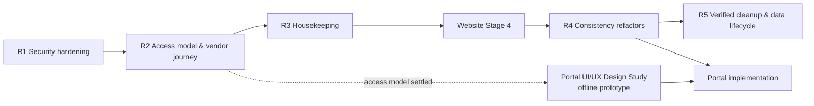

# Architecture remediation plan

[Blueprint](EXPRESSO-SYSTEM-BLUEPRINT.html) · [Executive summary](README.md) · [Cleanup audit](CODE-CLEANUP-AUDIT.md) · [Reset plan](DATABASE-RESET-PLAN.md)

**Status: approved planning baseline (`852369df`).** The original plan below (sections 1–11: item timings, the five-stage sequence R1 → R2 → R3 → Website Stage 4 → R4 → R5, then the design study and portal implementation) is kept as written. What was actually built, in what order, and which original stages remain open is recorded in [Implementation status](#implementation-status): the work did not follow the planned order. Committed: R1 (`b2958e76`), R2 (`26a2cca6`), the design study (`f0d9bc02`), the reliability stage labelled R3 (`91a0c0bc`) and portal implementation PUI-1 to PUI-5 (`516cc002`, `83bc9017`, `ffc5005c`, `ed68bb5c`, `3106b267`). The **R1/R3 closure** is committed (`23425ab8`). **Website Stage 4: code complete and committed (`feat: complete website stage 4`); homepage CMS content pending manual entry.** **R4 is in progress: R4-A (P3-5 / P3-6 access consistency) complete and committed (`refactor: align portal access controls`); R4-B (P2-6 / P3-8) complete and committed (`fix: remove R4 read and schema inconsistencies`); R4-C and R4-D not started. R5 has not started.** Nothing has been deployed, no deployment gate has been run, and no database data, infrastructure, storage, configuration or `.env` file has been changed by any stage.

**Baseline:** branch `website/integrated-solutions`. Application code is at `58b8f86c`; the architecture docs were committed at `e867d95f`.

**Method:** Each finding in the architecture audit was re-opened in the source before being listed here. Several findings got **wider** when re-checked:
- Project update and delete also lack company checks.
- Project "archive" actually deletes the record.
- The invite verification token is written to production request logs.

One finding was **narrower** than first described: invoice numbers fail with an error rather than duplicating. These corrections are listed in [section 8](#8-false-positives-corrections-and-runtime-confirmations).

## Implementation status

Status words used here: **Implemented** = code changed in the working tree · **Verified** = covered by automated tests that pass, and that fail against the pre-R1 code · **Pending** = not done yet (code, decision or runtime check).

### Original plan versus actual implementation (reconciled 26 Oct 2026)

The original sequence (section 10) was R1 → R2 → R3 → Website Stage 4 → R4 → R5, with the design study in parallel and portal implementation after both the study and R4. The actual order was R1 → R2 → design study → a reliability stage labelled "R3" → PUI-1 to PUI-5 → R1/R3 closure → Website Stage 4. R4 and R5 have not started, so portal implementation ran **before** R4, the reverse of the plan; the R4 items it was meant to absorb (P3-5, P3-6) are only partly done.

**Original stages, by their original contents**

| Original stage | Original contents | Status | Evidence / what remains |
|---|---|---|---|
| R1 Security hardening | P0-1–P0-4, P1-2, P2-3 invoices, `seedUser.js`, P3-1 meanings, P4-1, P4-3 | Code complete (R1/R3 closure committed in `23425ab8`) | P0-1–P0-4 in `b2958e76`; P2-3 invoices and `seedUser.js` in `91a0c0bc`; P1-2, P4-1, P4-3 and the `reports.export` part of P3-1 in the R1/R3 closure (`23425ab8`). Deployment checks pending |
| R2 Access model & vendor journey | P1-1, P1-3, P1-4, P1-5, P2-1, P2-3 RFQs, P2-4, P2-5, P3-4 | Code complete; one part deferred | `26a2cca6`; P2-4 and the RFQ counter in `91a0c0bc`. **Deferred:** RFQ unique index (needs the read-only duplicate check). Deployment checks pending |
| R3 Housekeeping | P3-3, P3-9, audit corrections | Code complete (R1/R3 closure committed in `23425ab8`) | Audit corrections were applied with the baseline. P3-3 and P3-9 in the R1/R3 closure. **Note:** commit `91a0c0bc`, labelled R3, delivered R1/R2 items (P2-3, P2-4, `seedUser.js`), not the original R3 housekeeping |
| Website Stage 4 | Homepage and remaining public pages | **W4 code: complete and committed. W4 CMS content: pending manual entry** | No detailed W4 specification existed; scope settled in the W4 pre-flight (26 Oct 2026). See [Website Stage 4](#website-stage-4-w4-code-complete-and-committed-cms-content-pending) |
| R4 Consistency refactors | P2-2, P2-6, P3-5, P3-6, P3-7, P3-8 | **In progress (not complete)** | Split into passes (26 Oct 2026): **R4-A** P3-5 / P3-6 complete and committed; **R4-B** P2-6 + P3-8 complete and committed; **R4-C** P2-2, **R4-D** P3-7 not started. See [R4](#r4-consistency-refactors-in-progress-r4-a-and-r4-b-committed) |
| R5 Verified cleanup & data lifecycle | P3-2, P4-2, P4-4, P4-5, P4-6, P2-7 pipeline | **Not started** | Needs backup with tested restore, database export and access-log review first |
| Design study | Offline prototype and component specification | **Done** | `f0d9bc02` |
| Portal implementation | Shared components, then Dashboard, CRM, Projects, Finance, HR, Procurement, absorbing P3-5 and P3-6 | **Partial** | PUI-1 to PUI-5 cover all listed modules plus client and vendor views. Open: the Jobs board page (legacy UI), and the P3-5 / P3-6 remainder |

**Actual implementation history (commits on `website/integrated-solutions`)**

| Commit | Label | Delivered | Deployed |
|---|---|---|---|
| `b2958e76` | R1 | P0-1, P0-2 (company checks), P0-3, P0-4 | No |
| `26a2cca6` | R2 | P0-2 external-role policy, P1-1, P1-3, P1-4, P1-5, P1-6, P2-1, P2-5, P3-4 | No |
| `f0d9bc02` | Design study | Offline prototype and design-system specification | n/a |
| `91a0c0bc` | "R3" reliability | P2-3 (invoice counter; RFQ counter, index blocked), P2-4 (archive), P2-7 `seedUser.js` | No |
| `516cc002` | PUI-1 | Portal design system and application shell | No |
| `83bc9017` | PUI-2 | Staff dashboard and Projects; client project field boundary | No |
| `ffc5005c` | PUI-3 | Clients and CRM; customer endpoint boundaries | No |
| `ed68bb5c` | PUI-4 | Finance, HR, Procurement; RFQ-from-request boundary and budget copy | No |
| `3106b267` | PUI-5 | Client and vendor portal; ticket, file-link and billing boundaries; vendor `quoted=true` list | No |
| `23425ab8` | R1/R3 closure | P1-2, P4-1, P4-3, P3-1 `reports.export`, P3-3, P3-9, status update | No |
| `feat: complete website stage 4` | Website Stage 4 | Digital Solutions catalogue and Business Suite page; Services and Portfolio load states; homepage eyebrow rule; placeholder badges removed | No |
| `refactor: align portal access controls` | R4-A | P3-5 / P3-6 access consistency: no `admin` name bypass in the route guard or navigation, session refresh on focus, menu/route alignment, permission-gated delete actions, internal-only file deletion, one role-hierarchy helper | No |
| `fix: remove R4 read and schema inconsistencies` | R4-B | P2-6 settings reads never write; P3-8 one access-request `status` index and a `vendor` comment author type | No |

No deployment gate listed under R2, R3 or section 8 has been performed.

### Website Stage 4 (W4: code complete and committed; CMS content pending)

The repository defined W4 only as "the next website implementation stage (homepage and remaining public pages)". Scope was settled in the W4 pre-flight from the approved Digital Solutions / Business Suite direction, the four approved homepage slides and the gaps documented in [PUBLIC-WEBSITE-MAP.md](PUBLIC-WEBSITE-MAP.md). No database, CMS schema or media change. The only API and portal change is the homepage-slide eyebrow fix below.

| Part | Status | Detail |
|---|---|---|
| Digital Solutions catalogue, CAS and Expresso Business Suite pages | **Code complete** | `/digital-solutions` catalogue; `/digital-solutions/cas` unchanged; `/digital-solutions/business-suite` with 7 modules, sanitised product visuals and one final demo CTA; both products remain with zero CMS records; menu and sitemap entries |
| Services list states | **Code complete** | Loading, error with retry, empty and success are distinct; a failed request is no longer an empty list |
| Portfolio states | **Code complete** | The shared list reports failures; `/portfolio`, `/case-studies` and `/case-studies/:id` show error with retry; the detail page shows "not found" only for HTTP 404 |
| Placeholder badges | **Code complete** | Services "NEW!" badge and the Portfolio page's `yourportfolio.com` link removed |
| Homepage eyebrows | **Code complete** | A blank eyebrow stays blank end to end: the website hides it; `POST /api/homepage/slides` stores an explicitly blank eyebrow as blank (the old defaults apply only when the field is not sent); the portal's new-slide form starts with a blank second eyebrow and its preview hides blanks. Records that predate the fields keep the old defaults on the website and in the edit form. Existing slide records unchanged |
| Four new homepage slides | **CMS content: pending manual entry** | Upload the four images in `client/public/images/homepage/` to the Media Library, then create the slides in Portal → Website → Homepage slides with the second eyebrow left blank and Order values after the existing five. Not seeded, not hard-coded |
| Contact form `?interest=` capture | Not in W4 (optional future enhancement) | The Business Suite CTA keeps `/contact-us?interest=business-suite-demo` |
| Dynamic sitemap | Not in W4 | The static sitemap remains; it lists the Business Suite route |

### R4 consistency refactors (in progress; R4-A and R4-B committed)

The original R4 is P2-2, P2-6, P3-5, P3-6, P3-7 and P3-8 (section 10). None is deferred; it is delivered in four controlled passes. **R4 is not complete.**

| Pass | Items | Status |
|---|---|---|
| R4-A | P3-5, P3-6 (access consistency) | **Complete and committed** |
| R4-B | P2-6 (settings read without write), P3-8 (duplicate index, ticket comment role) | **Complete and committed** |
| R4-C | P2-2 (CRM conversion atomicity and link field) | Not started |
| R4-D | P3-7 (duplicated sources of truth) | Not started |

**R4-A detail.** Backend unchanged in principle: the API reloads the user and resolves permissions from the database on every request; `super_admin` is the only bypass.

| Change | Detail | Tests |
|---|---|---|
| Route guard | `ProtectedRoute.isAllowed` no longer lets `admin` through by name; `super_admin` keeps its bypass, everyone else needs the route permission. The role comes from the user last confirmed by `/auth/me`, with the token's role only as a fallback | `app/r4aAccess.test.jsx`; `useAccess.test.js` updated (it pinned the old bypass as deferred) |
| Navigation | `portalNav` filters `admin` by permissions like any other role (`super_admin` keeps the full menu). A default admin sees the same menu as before | `app/r4aAccess.test.jsx` |
| Menu / route alignment | Digital Services and Tech Solutions editors: menu `website.write` → `website.read` (matches the route). Skill Matrix: menu and route `hr.scorecards.read` → `hr.staff.read` (the permission its data needs) | `app/r4aAccess.test.jsx` |
| Session refresh | `PortalLayout` re-reads `/auth/me` when the window regains focus or becomes visible, at most once a minute; `writePortalSession` stores it and signals `useAccess`, the route guard and the menu to re-evaluate. No polling, sockets or new session model | `app/r4aAccess.test.jsx` |
| Delete actions | Staff Files: Delete shown only with `files.delete`. Staff ticket: Delete shown with `tickets.delete` (was: role name `super_admin`) | `app/r4aAccess.test.jsx` |
| File deletion (API) | `deleteFile` requires an internal user **and** `files.delete` (was: role name `admin`/`super_admin`). Internal custom roles with the permission now work; client and vendor users stay refused even if granted `files.delete`, because deletion has no company scoping | `portal-api/test/r4a-access.test.js` |
| Role hierarchy | `canManageRole` now has one implementation, `portal-api/src/utils/roleHierarchy.js`, used by users, invites and access requests (two live copies and one unused copy removed). Rule unchanged; protected-role, self-management and last-super-admin guards untouched | Equivalence matrix over every actor × target pair, plus route checks for users, invites and access requests |
| Unused helpers | `shared/ui/Can.jsx` and `shared/hooks/usePortalPermissions.js` deleted: no importers, never used since added, superseded by `useAccess`; `usePortalPermissions` had no `super_admin` bypass (the API sends super_admin an empty permission list), so adopting it would have hidden every control from super admins | — |

Kept as intentional: the API's `super_admin` bypass, protected-role and self-management rules, last-super-admin protection, vendor/client workspace selection, and the portfolio rule that only `admin`/`super_admin` edit slug, tags, SEO and sort order (no permission key exists for it).

Found, not changed in R4-A: the legacy staff ticket page's `isAdminRole` list of internal role names (gates staff tools; custom internal roles do not get them) and save/delete controls on about 27 older pages that are not permission-gated; both belong to those modules' migration (PI tail). `billing.delete` is catalogued but has no route (decision, outside R4).

**Deployment gate (still open):** role-editor round trip with a real session (edit and save a stored role, including keys the editor does not list, reopen and compare).

**R4-B detail** (complete and committed; code only, no database operation or data change).

| Item | Change | Tests |
|---|---|---|
| P2-6 | `settings.controller.js` `readSettings` replaces `getOrCreate`: both `GET /api/site-settings/public` and `GET /api/site-settings` return the stored `site` document, or the model defaults built in memory (`new SiteSettings({ _id: "site" }).toObject()`) without saving. The response is still `{ ok: true, settings }`. `updateSettings` is unchanged: its upsert (`setDefaultsOnInsert`) creates the singleton on the first admin save. This also removes the duplicate-key 500 two simultaneous first reads could cause | `portal-api/test/r4b-consistency.test.js`: no-record public and admin reads (no write of any kind), repeated reads, stored values, first and later PATCH upsert the same singleton. The no-write tests fail against the previous code |
| P3-8 index | Removed `AccessRequestSchema.index({ status: 1 })`; `status` keeps `index: true`. Same single `status_1` index in MongoDB, so no index operation. The Mongoose duplicate-index warning (the only one in the API) is gone | Schema metadata (one each of status, workEmail, createdAt) and a fresh-process load with no warning; both fail against the previous model |
| P3-8 comment author | `authorRole` is the author type, not the RBAC role. Enum widened to `client`, `admin`, `vendor`. Internal users (super_admin, admin, staff, custom internal roles) stay `admin`; an external user with an active vendor profile (the API's vendor rule, R2) is `vendor`; other external users stay `client`. Status-change and approval entries stay `admin`. Staff thread labels: Team / Vendor / Client. The client and vendor view needs no change (staff → "Expresso", colleagues → "Your team", own → "You"). Historical vendor comments keep `client` (no migration). Known edge case (kept by decision): an external user whose vendor profile is inactive is not an active vendor under the R2 rule, so new comments from them are labelled `client` | API: each persona, schema validation, status and approval entries, company and internal-ticket boundaries. Client: `features/tickets/ticketAuthors.test.jsx` |

### R1/R3 closure (committed in `23425ab8`; not deployed)

Closes the original Stage 1 and Stage 3 items left open. No database, script, migration or deployment action; no website file touched.

| ID | Implemented | Automated tests | Still pending |
|---|---|---|---|
| P1-2 | **Implemented** — `deleteUser` imports the customer model statically from the correct file (`customer.model.js`; the old dynamic import pointed at a non-existent `customers.model.js`, so the account was deleted, then the request returned 500 and no audit entry was written). After a successful delete, the company-owner unlink (`Customer.ownerUserId`, client-linked users only, as before) runs in its own guard: a failure there is logged and recorded in the audit entry (`meta.customerUnlinkFailed`) and the response is still success. The `user.deleted` audit entry is always written after a delete. Authorization, self-delete and last-super-admin guards unchanged. No delete-vs-deactivate change | **Verified** — 7 tests in `portal-api/test/r1r3-closure.test.js` (client-linked delete with unlink and audit; user without company; unlink failure; failed delete writes nothing; self-delete; last super admin; role hierarchy). The 2 delete-success tests fail against the previous code | Decision on deactivate vs delete for users who own records. Other references to a deleted user (projects, CRM, tickets, jobs, internal `ownerUserId`) are still not handled (unchanged). Read-only check for customers whose `ownerUserId` points at a missing user (data clean-up only) |
| P4-1 | **Implemented** — 24 zero-byte source files deleted (20 client, 4 API), each re-checked: no relative import, require or dynamic import resolves to it (resolver over `client/src`, `portal-api/src`, `portal-api/test`, `docs/architecture`; the client has no path aliases). Two directories left empty were removed. `portal-api/README.md` (empty, documentation) kept | Client and API suites, build | — |
| P4-3 | **Implemented** — `middleware/rbac.js`, `requirePerm.js`, `roles.js`, `utils/apiFeatures.js`, `apiResponse.js`, `resolvePermissions.js` deleted: no importer in source, tests or scripts; the remaining mentions are the live `requirePermission` export of `auth.js`, a search keyword and documentation | API suite | — |
| P3-1 (`reports.export`) | **Implemented** — removed from the catalogue and the `finance` default (73 keys). No API route, middleware, client check or script used it. Stored strings are tolerated: role and user permission lists are already filtered against the catalogue on resolution, display and save, so a stored `reports.export` is ignored and nothing else changes | **Verified** — 4 tests (catalogue, defaults, stored role and user extras still resolve); R2 catalogue test updated to 73 | Optional read-only report of Role documents and users still storing `reports.export` (no access effect; cosmetic clean-up only). `reports.read` stays a page gate whose data is authorized by each module's own permissions |
| P3-3 | **Implemented by decision: no user-notes feature.** The orphaned `getUserNotes` / `saveUserNotes` helpers (calling a non-existent `/api/users/:id/notes`) were removed. The working user Notes tab is unchanged: it saves the user's `notes` field through `PATCH /api/users/:id`. No backend route created | Client suite, build | — |
| P3-9 | **Implemented** — `API_ENDPOINT_COVERAGE_COMPLETE.csv` regenerated from `source-inventory.json` by the new `docs/architecture/generate-endpoint-csv.cjs`: 283 endpoints (220 kept with their IDs, test design and QC columns; 63 added as API-221–API-283 with code-derived columns only and "Not Run"; none dropped). Guard, permission and source-file columns of kept rows refreshed from the code (36 guard and 5 permission values were stale). `validate.cjs` now fails if the sheet is stale. Files moved: `STAGE-3-TECHNOLOGY-VENDOR.md`, `STAGE-3.5-FUNCTIONAL-CLEANUP.md` → `docs/stages/`; `API_ENDPOINT_COVERAGE_COMPLETE.csv`, `USE_CASES_QC.csv`, `USE_CASES_QC_COMPLETE.csv`, `USE_CASES_QC_COMPLETE.xlsx` → `docs/qc/`; `EXPRESSO_ERP_FUTURE_ENHANCEMENT_PLAN.docx` → `docs/planning/` | Validator | The use-case QC sheets are moved unchanged (they are use-case lists, not generated from code) |

### Stage R3 — reliability and data consistency (committed in `91a0c0bc`; not yet deployed)

Labelled R3 when built; it delivered original Stage 1/2 items (P2-3, P2-4, `seedUser.js`), not the original Stage 3 housekeeping, which was done in the R1/R3 closure above.

| | |
|---|---|
| **R3 implementation** | **IMPLEMENTED AND AUTOMATED-TEST VERIFIED** for the items below, except where marked blocked or deferred |
| **Blocked by read-only data check** | P2-3 RFQ part: the **unique index on `rfqNumber`** (needs the read-only duplicate aggregate in section 8). New RFQ numbers no longer repeat without it |
| **Read-only reports before deployment** | (1) Duplicate `rfqNumber` values (aggregate in section 8). (2) Records already orphaned by earlier permanent project deletes: jobs, invoices, files, tickets and enrollments whose `projectId` has no project. Neither is needed for the R3 code; both are needed before cleaning up old data |
| **Schema / index / migration** | One new collection, `counters` (model `Counter`, SYSTEM), written by the app on first use; no index beyond `_id`; no migration (each counter starts from the highest number already stored). Allocation relies only on MongoDB single-document atomicity (`$inc`, an insert refused by the unique `_id`, `$max`), never on in-process state, so it is safe with several API instances. During a rolling deploy, instances still running pre-R3 code can produce a colliding number: invoices recover (unique index, retry); RFQs could duplicate until the index exists. No other schema change: projects already had `status: "archived"` and `archivedAt` |

| ID | Implemented | Automated tests | Still pending |
|---|---|---|---|
| P2-3 (invoices) | **Implemented** — invoice numbers come from an atomic per-year counter (`utils/sequence.js`, `counters` collection) that starts above the highest existing `INV-YYYY-NNNN`; format and the unique index unchanged; a hand-entered number in the standard format (create or edit) moves that year's counter past it with `$max`, so automatic numbering never runs into it; if the counter is still behind (e.g. a number written by older code), creation moves it past and retries; each attempt is one write, so no partial invoices; a duplicate hand-entered number is a 409 on create and update instead of a 500; if the counter itself fails, the response is a 503 and nothing is created | **Verified** — 14 API tests in `portal-api/test/r3-reliability.test.js`: simultaneous creations with an existing counter and with **no counter yet** (20 requests race the bootstrap; one insert wins; numbers start strictly above the highest existing), manual numbers, year boundary (2026/2027), allocation failure, and a check that allocation keeps no in-memory state. 9 of the 10 request-level tests fail against the pre-R3 code (the one that passes, "start above the highest number", already held) | — |
| P2-3 (RFQs) | **Partly implemented** — RFQ numbers (both creation paths) come from the same per-year counter, starting above the highest existing `RFQ-YYYY-NNNN`; deletions and simultaneous creation no longer repeat numbers; existing numbers, including any duplicates, are left as they are | **Verified (code)** — 7 API tests (simultaneous creations with and without an existing counter, deletion, old count-based numbers, year boundary 2026/2027/2028, create-from-request, allocation failure → 503 with no RFQ); all 5 request-level tests fail against the pre-R3 code. RFQ numbers are not user-editable, so there is no manual-number path. **Uniqueness is not database-enforced** until the index exists | **BLOCKED BY READ-ONLY DATA CHECK:** unique index on `rfqNumber` |
| P2-4 | **Implemented** — `DELETE /api/projects/:id` archives (`status: "archived"`, `archivedAt`) and never deletes; linked jobs, invoices, files, tickets and enrollments are untouched; repeating it is harmless; project lists hide archived projects unless `status=archived` or `includeArchived=true`; company boundary (R1) and the external-role refusal (R2) unchanged; the portal's trash button is now an archive button whose confirmation says history is kept, and the default status filter reads "All except archived" | **Verified** — 7 API tests in `r3-reliability.test.js` (the 4 archive tests fail against the pre-R3 code; the boundary, R2 refusal and direct-access tests pass on both, as intended), 3 R1 boundary tests updated to check the archive write, 3 client tests. An archived project can still be opened directly. `GET /api/projects/stats` (Reports) still counts all projects, with archived as its own status, and the job list's project-type filter still includes jobs of archived projects; both are history views, not the active project list; **kept by decision (21 Oct 2026)**, with archived shown as its own status | Read-only orphan report for earlier permanent deletes (data clean-up only). There is no hard-delete route and no restore action beyond changing the status |
| P2-7 (`seedUser.js` only) | **Partly implemented** — `seedUser.js` is insert-only: an existing email is left unchanged (exit 1); `--reset-password` needs an existing account that is already super_admin, changes only `passwordHash` and `passwordChangedAt` (the write is guarded by `role: "super_admin"`), never creates or promotes an account and never touches permissions, company or profile fields; a concurrent creation is refused by the unique email index; the legacy `permissions` field is no longer written; importing the script doesn't run it | **Verified** — 8 tests with stubbed models (the script was not run against any database) | **DEFERRED:** backup/reset/seed pipeline (Stage 5) |

Deferred from R3 by the plan's own timing: **P2-2** (CRM conversions, after Stage 4), **P2-6** (settings read without write, after Stage 4) and the **P2-7 pipeline** (Stage 5). P1-2 is a P1 item and was not part of this P2 stage (fixed later in the R1/R3 closure).

### PUI-5 findings (23 Oct 2026; committed in `3106b267`; not yet deployed)

| Finding | Status | Automated tests | Still pending |
|---|---|---|---|
| Tickets of type `internal` linked to a client's company were returned to that company's users (list, stats, detail, comments): the external filter matched on company only, and a `type=internal` query parameter replaced it. Client users could also create `internal` tickets (then hidden from staff triage views by type) | **Implemented** — external users never receive `internal` tickets (`ticket.controller.js`: list and stats filter, `canAccessTicket`, type filter limited to external types); an external user asking to create one gets a `support` ticket; staff unchanged | **Verified** — 3 tests in `test/pui5-external-boundaries.test.js` (all fail against the previous code) | — |
| An external file upload accepted any `projectId`, `jobId` or `productionId`; the file list and detail populate those links, so a client could read another company's project or job name and status, or a production's | **Implemented** — external uploads may link only to their own company's project or job, never to a production (400 otherwise, nothing stored); staff uploads unchanged | **Verified** — 3 tests (the refusal test fails against the previous code; the own-project and staff tests pass on both) | — |
| `GET /api/billing/invoices/:id` returned the staff member who recorded each payment (name and email) to client users | **Implemented** — client users receive payments without `recordedBy` (detail and list); staff unchanged; company isolation unchanged | **Verified** — 2 tests (the exposure test fails against the previous code) | — |
| Vendors could open a closed or awarded RFQ they had quoted on (R2 rule), but no list showed those, so "what have I quoted on" had no answer | **Implemented** — `GET /api/procurement/rfqs?quoted=true` for vendors lists RFQs they quoted on, in their approved categories, published or later (never drafts), with vendor-safe fields; the default vendor list is unchanged | **Verified** — 2 tests (the new list fails against the previous code; the default-list test passes on both) | — |
| An external user creating a ticket can set any `projectId`; it isn't populated back to them (no leak), but it attaches their ticket to another company's project in staff views | **Not changed** | — | Validate the project's company on external ticket creation (as for files) |
| Ticket responses to client users include the assignee's email (`assigneeId` populated with `fullName email avatarUrl`); the portal shows the name only | **Not changed** — the handler is treated as client-facing | — | Decide whether external users should get the email |
| Notes on client-visible files are returned to and shown to the client | **Not changed** — existing behaviour | — | Confirm staff treat file notes as client-facing |
| There is no vendor-facing profile endpoint: a vendor can't see its own approved categories or profile details in the portal | **Not changed** — no profile page was invented | — | Decide whether vendors need a read-only profile |

### PUI-4 findings (23 Oct 2026; committed in `ed68bb5c`; not yet deployed)

| Finding | Status | Automated tests | Still pending |
|---|---|---|---|
| `POST /api/procurement/requests/:id/create-rfq` needed only `procurement.write`, which default client roles hold, and has no company check: a client user could create an RFQ from any company's request and move that request to Assessing | **Implemented** — the route now requires an internal user, like every other RFQ write (`request.routes.js`); staff behaviour and R3 numbering unchanged | **Verified** — `test/pui4-procurement-rfq.test.js` (the 2 client tests fail against the previous code; the staff-permission test passes on both) | — |
| An RFQ created from a request copied the request's internal budget ("Estimated Budget: …") into its description, which matched vendors read once it is published | **Implemented** — new RFQs from requests carry the description and requirements only (`rfq.controller.js`); the request page's confirmation says the budget stays internal, and the RFQ form reminds staff to keep budgets out of descriptions | **Verified** — 1 test in `pui4-procurement-rfq.test.js` (fails against the previous code) | Existing RFQs already created this way keep the line. Read-only check: count RFQs whose `description` contains `Estimated Budget`; drafts can be edited by staff, published ones can't (data clean-up only, not done here) |
| Billing: removing a payment recalculates `amountPaid` and `balance` but leaves the status, so a Paid invoice stays Paid with a balance | **Not changed** — the confirmation says the status is not reopened | **Verified (UI)** | Decide whether removing a payment should reopen the invoice |
| Billing: `payments.recordedBy` is populated with `name email`, but users store their name as `fullName` | **Not changed (backend)** — the portal falls back to the email | **Verified (UI)** | Populate `fullName` |
| Billing: client users can see Draft invoices of their company | **Not changed** — existing behaviour | — | Decide whether drafts should be hidden from clients |
| HR: `PATCH /api/hr/expenses/:id` accepts `staffUserId` from anyone with write access (unlike leave, which ignores it for self-service), and any value that isn't an id clears it. The portal's edit forms sent the loaded, populated `staffUserId` object, which cleared the owner, after which the claimant could no longer see the claim | **Implemented (UI)** — the expense and leave forms send only their own fields | **Verified (UI)** — client test | Server: ignore `staffUserId` for self-service and reject non-id values |
| HR: `markExpensePaid` has no status check and `cancelLeave` cancels any status | **Not changed (backend)** — the portal offers Mark as paid only for registered, unpaid claims, and Cancel only for submitted or approved leave | **Verified (UI)** | Server-side status guards |
| HR: KPI goals and check-ins, including other people's individual goals, are readable by anyone with `hr.kpi.read`, which the default `staff` role holds | **Not changed** — policy question; the portal gives read-only users no KPI actions | **Verified (UI)** | Decide KPI visibility per person |
| HR: the Skills page is opened with `hr.scorecards.read` (held by default `staff`), but its data needs `hr.staff.read`, so it failed for most users | **Implemented (UI)** — the page says it needs staff-record access instead of failing | **Verified (UI)** | Align the route and navigation permission (with P3-5) |
| HR: a staff record's leave and expense tabs listed the 20 newest records of everyone (the list APIs ignore `staffName`), and its analytics tab added leave days from a field that doesn't exist (always 0) and expenses across all staff | **Implemented (UI)** — the tabs show only records matching the person's exact name or linked portal user, from up to 100 name matches, and say so; the analytics tab is removed and the department comparison (computed by the API) is shown on the Overview | **Verified (UI)** | An exact staff filter on the leave and expense list APIs |
| HR: monthly expense totals and the department comparison add amounts across currencies (each claim has a free-text currency) | **Not changed** — the portal shows these as plain figures and says there is no conversion; list metrics are counts only | **Verified (UI)** | Decide on currency handling |
| HR: deleting a staff record is permanent and leaves KPI goals (`staffId`) and reporting lines (`managerStaffId`) pointing at it | **Not changed** — the confirmation says so and suggests Inactive or Terminated | **Verified (UI)** | Reference checks or archive (as P2-4 for projects) |
| Procurement: deleting a vendor or a category is permanent and checks only procurement requests. A vendor's quotations, portal login and application, and a category's vendors, RFQs, applications and subcategories, are left pointing at it | **Not changed** — the confirmations say so and offer deactivation (nothing deleted) | **Verified (UI)** | Reference checks or archive |
| Procurement: accepting a quotation sets the RFQ to Awarded (even when closed) but leaves the other quotations as they are, so several can be accepted | **Not changed** — the confirmation says other quotations keep their status | **Verified (UI)** | Decide whether accepting one should reject the others |
| Procurement: request status changes are unrestricted (any status to any other) | **Not changed** — kept as the existing workflow; each change is stamped in the request's timeline, which the portal now shows (it previously read the dates from the wrong place) | **Verified (UI)** | — |

### PUI-3 findings (22 Oct 2026; committed in `ffc5005c`; not yet deployed)

| Finding | Status | Automated tests | Still pending |
|---|---|---|---|
| Client users received internal company information from the customer endpoints behind the Clients screens: `GET /api/customers` and `GET /api/customers/:id` returned the company's internal `notes`, and the detail populated the linked CRM account and deal (title, stage, value) | **Implemented** — client users never receive `notes`, `crmAccountId` or `crmDealId`; the CRM links are not populated for them (`customers.controller.js`, `CLIENT_HIDDEN_CUSTOMER_FIELDS`, inclusion field lists); staff responses and company isolation unchanged. The portal also keeps them out of the client layout | **Verified** — `test/pui3-customer-boundaries.test.js` (the 3 exposure tests fail against the previous code; the staff and isolation tests pass on both) and client tests | — |
| `GET /api/customers/:id/users` had no company check, so a client user with `customers.read` could list another company's portal users (names, emails, roles) | **Implemented** — client users can list only their own company's users (403 otherwise); staff unchanged | **Verified** — 2 tests in `pui3-customer-boundaries.test.js` (the cross-company test fails against the previous code) | — |
| Deal-to-client conversion (`convertDealToCustomer`) has no server-side once-only guard; the CRM account it may create is not stored on the deal (`accountId`), so a second run creates another account; it sets the stage to `won` whatever the current stage; it reuses any existing client with the same email or company name | **Not changed (backend)** — recorded under P2-2. The portal offers conversion only for a Won deal without a client (detail page and list), never again once converted, guards against double submission, and its confirmation states the reuse rule. Lead conversion also gets a double-submission guard | **Verified (UI)** — client tests for the conversion conditions and double submission | Server-side idempotency and atomicity (P2-2) |
| Client and CRM deletes are permanent (`findByIdAndDelete`) with no checks for linked records: deleting a client leaves its projects, jobs, invoices, files, tickets and portal users pointing at a client that no longer exists; deleting a deal, lead, account or contact leaves links on the others | **Not changed** — pre-existing behaviour, kept. The portal shows delete only with the matching `*.delete` permission, says the record can't be restored and what stays behind, and offers client deactivation (nothing deleted) as the alternative | **Verified (UI)** — client tests for the delete permission and wording | Decide on archive or reference checks for clients and CRM records (similar to P2-4 for projects) |
| Deactivating a client does not stop its portal users signing in (sign-in checks the user, not the company) | **Not changed** — documented in the deactivation confirmation | **Verified (UI)** | Decide whether client deactivation should also block its users |

### PUI-2 review findings (21 Oct 2026; committed in `83bc9017`; not yet deployed)

PUI-1 (design system and application shell, `516cc002`) recorded no separate findings.

| Finding | Status | Automated tests | Still pending |
|---|---|---|---|
| Client users received a project's internal notes and internal budget (`GET /api/projects`, `GET /api/projects/:id`) | **Implemented** — by decision, client users never receive `notes` or `budget`: both project queries exclude them for non-internal users (`project.controller.js`, `CLIENT_HIDDEN_PROJECT_FIELDS`, projection `{ notes: 0, budget: 0 }`); a client's project search no longer matches inside notes; staff responses and company isolation unchanged. Client commercial information comes from client-facing billing. The portal also keeps both out of the client layout | **Verified** — `test/pui2-client-project-fields.test.js` (6 project tests; the 3 exposure tests fail against the previous code, the staff and isolation tests pass on both) and client tests for the client project view and list | — |
| Job detail (`GET /api/jobs/:id`) includes the project budget | **No change needed** — `jobs.*` is externally denied (R2), so only internal users can read jobs | — | — |
| UI treated the `admin` role as unrestricted; the API bypasses checks for `super_admin` only | **Implemented for PUI-1/PUI-2 code** — `useAccess` (dashboard and Projects decisions and links), the shell's ticket action and the client dashboard links now use effective permissions; new `isAllowedByPermissions` applies the route rules without the role-name bypass. Server privileges unchanged | **Verified** — `useAccess.test.js`, staff dashboard and shell tests with a limited `admin` | **Deferred under P3-5 (Stage 4):** the pre-existing route guard `ProtectedRoute.jsx` `isAllowed` (role-name bypass for `admin`) and the navigation filter `portalNav.js` `getNavSectionsByRole` / its permission check (`ROLES.ADMIN` bypass) still let `admin` through by name. Changing them alters page access for every module, so it waits for the P3-5 work |
| Client invoice list ignores `projectId` | **Confirmed not a security issue** — `GET /api/billing/invoices` always limits clients to their own company (a client without a company gets an empty list) and `GET /api/billing/invoices/:id` returns 403 for another company's invoice | **Verified** — 2 tests in `pui2-client-project-fields.test.js` | **Later API consistency item:** honour `projectId` for client users. Until then the project Billing tab filters the client's own invoices to the project |

### Stage R1 — P0 security (committed in `b2958e76`; not yet deployed)

| ID | Implemented | Automated tests | Still pending |
|---|---|---|---|
| P0-1 | **Implemented** — `optionalAuth` middleware; portfolio and productions lists/details force `status: published` and services/solutions lists/details force active records unless the caller holds `portfolio.read`, `productions.read` or `website.read`. Failed authentication (invalid, expired or deactivated) falls back to anonymous: public content stays available and no draft privilege is granted | **Verified** — 39 tests in `portal-api/test/r1-security.test.js`, including anonymous, authorised CMS, signed-in without permission, invalid-token and expired-token cases for all four content types | Staging check that the portal CMS still lists drafts with a real session. Draft records already exposed before the fix are not retractable |
| P0-2 | **Implemented** — tenant/company isolation: company checks on project create, update (including `customerId` and internal-mode changes) and permanent delete, and on ticket delete | **Verified** — 16 tests (tenant/company isolation) | **External-role permission policy: implemented and verified in R2** — `projects.write`, `projects.delete` and `tickets.delete` are external-denied: stripped at sign-in and refused by the role and user-permission editors (API). DELETE remains a permanent delete for internal users (P2-4) |
| P0-3 | **Implemented** — self-delete guard compares `req.user.id`; the last active super admin cannot be deleted, deactivated or demoted (delete, status and user-edit paths) | **Verified** — 8 tests | P1-2 (client-linked user delete crash, same function) is a separate P1 item and was not changed in R1; fixed in the R1/R3 closure |
| P0-4 | **Implemented** — request logger drops query strings and private-file path tokens from both the URL **and the Referer** (which carried `/portal/accept-invite?token=` and `/portal/reset-password?token=`) | **Verified** — 3 tests, including the real app's logger | Log retention, access and purging of logs written before the fix (Hassan's decision); optional move of invite verification to a POST body was not done |

### Stage R2 — access model and vendor journey (committed in `26a2cca6`; not yet deployed)

| | |
|---|---|
| **R2 implementation** | **IMPLEMENTED AND AUTOMATED-TEST VERIFIED** |
| **Deployment verification** | **PENDING — READ-ONLY ROLE/USER IMPACT REPORT** (not run: the configured remote database could not be safely identified as development or staging) |
| **Required before deployment** | (1) Read-only report of saved roles with an explicitly empty permission list, or only obsolete/unknown permissions, with assigned-user counts. (2) Read-only report of external (client/vendor) roles and users carrying `projects.write`, `projects.delete` or `tickets.delete`, by role and as personal extras. (3) Staging/manual verification of the vendor journey: apply → approve → Vendor Portal invitation email → accept → log in → see matching published RFQs → submit a quotation |
| **Known remaining race (accepted; not addressed in R2)** | `procurementvendors.applicationId` has no unique constraint. If the process dies during the narrow clean-up window of two concurrent approvals, an extra unlinked vendor profile can remain. It grants no access. Belongs to later consistency/data work; see "P2-1 compensation limit (R2)" |

| ID | Implemented | Automated tests | Still pending |
|---|---|---|---|
| P1-1 | **Implemented** — RFQ read routes admit internal staff or approved vendors (active vendor profile, not role name); vendors get published RFQs in approved categories, closed/awarded only if they quoted, own quotations only, vendor-safe fields; portal lets vendors open RFQ list/detail | **Verified** — 11 API tests in `portal-api/test/r2-access.test.js`, 3 client gate tests | Staging check with a real vendor account; vendors approved under the old flow keep their existing logins |
| P1-3 | **Implemented** — portal permission copy removed; role editor and access tab load `GET /api/permissions/catalog` (74 keys, defaults, external-denied list); editor no longer drops keys on toggle | **Verified** — 2 API catalogue tests, 3 client tests | Visual check of the role editor with a real session |
| P1-4 | **Implemented** — `GET /api/users/:id/effective-permissions`; access tab shows stored-role, default or none, plus overrides | **Verified** — 3 API tests | — |
| P1-5 | **Implemented** — `/portal/hr/kpi` gated by `hr.kpi.read` | **Verified** — 2 client tests | — |
| P2-1 | **Implemented** — invitation-based vendor onboarding (expiring, single-use, no password shown; the email names the Vendor Portal); approval writes ordered with clean-up and a conditional status change, and a repeated approval resumes an interrupted one (reuses the unlinked profile, replaces the undelivered invitation); acceptance claims the invitation atomically, links the vendor profile before the account exists, and can be completed with the same link after an interruption | **Verified** — 27 API tests: `r2-vendor-approval.test.js` (16: wording, double-click and 5-way concurrent approval, retry after compensated failure, resumed approval), `r2-vendor-acceptance.test.js` (6: single use, concurrent acceptance, failed linking, failed account creation then retry, interrupted acceptance), `r2-vendor-acceptance-guards.test.js` (4), and the token-logging test in `r2-access.test.js` | No database transaction. A remaining crash window and its recovery are described under "P2-1 compensation limit (R2)" below; recovery uses the normal Approve / Resend actions, not manual database repair |
| P2-5 | **Implemented** — explicit empty role permission list = no access; role list shows stored lists as stored | **Verified** — 6 API tests | **Read-only check before release:** built-in Role documents whose stored list is empty or contains only obsolete keys would lose access |
| P3-4 | **Implemented** — `/portal/productions` route gate and menu use `jobs.read` | **Verified** — 2 client tests | — |

Deferred from R2: **P2-3** RFQ numbering (needs the read-only duplicate check) and **P2-4** archiving (later workstream by decision).

### Business decisions recorded (20 Oct 2026)

| Topic | Decision | Applies in |
|---|---|---|
| External roles and projects/tickets (P0-2 part b) | External/client roles must not receive general project create, edit or delete capability. Clients may view projects belonging to their company and use only specifically designed client actions. Clients must never hard-delete tickets | Implemented in R2 |
| Vendor RFQ visibility (P1-1) | Published RFQs matching the vendor's approved categories, plus the vendor's own quotations | Implemented in R2 |
| Vendor authentication (P2-1) | Email invitation using an expiring, single-use token | Implemented in R2 |
| Project deletion (P2-4) | Normal deletion should become archive behaviour | Implemented in R3 |
| Historical request logs (P0-4) | Do not purge yet; retention and access policy handled separately | Separate decision |

Decision taken during implementation: for productions, drafts are shown to holders of `productions.read` (as in P3-1), not `productions.write` as P0-1's "expected" row first said, so viewing drafts needs only the read permission.

## Priority scale

| Priority | Meaning |
|---|---|
| **P0** | Security, authorization or data exposure |
| **P1** | Broken business functionality |
| **P2** | Data integrity or reliability |
| **P3** | Architecture consistency and technical debt |
| **P4** | Cleanup candidates that need verification before anything is removed |

"Stage 4" means the next website implementation stage (homepage and remaining public pages). Fixes marked *before Stage 4* are server-side or admin-only and do not touch Stage 4's pages.

---

## 1. Summary

| ID | Issue | Priority | When | Data change? |
|---|---|---|---|---|
| P0-1 | Draft and inactive website content readable through public API | P0 | Before Stage 4 | No |
| P0-2 | Cross-company project create/update/delete; ticket delete without company check | P0 | Before Stage 4 | No (read-only check first) |
| P0-3 | User self-delete guard never fires; no last-super-admin protection | P0 | Before Stage 4 | No |
| P0-4 | Invite tokens written to production request logs | P0 | Before Stage 4 | No (log retention decision) |
| P1-1 | Approved vendors cannot read or answer RFQs | P1 | **Hassan's decision**, then before Stage 4 | No |
| P1-2 | Deleting a client-linked user crashes after the delete | P1 | Before Stage 4 | Possible clean-up of orphans |
| P1-3 | 8 API permissions cannot be managed in the portal (74 vs 66) | P1 | Before Stage 4 | No |
| P1-4 | Built-in role previews and defaults shown incorrectly | P1 | Before Stage 4 (with P1-3) | No |
| P1-5 | KPI pages gated by the wrong permission | P1 | Before Stage 4 (with P1-3) | No |
| P2-1 | Vendor approval writes three records without atomicity; temporary password handling | P2 | **Hassan's decision**, with P1-1 | Possible orphan clean-up |
| P2-2 | CRM conversions write several records without atomicity; duplicate link fields | P2 | After Stage 4 | Field migration (optional) |
| P2-3 | Invoice numbering race (error) and RFQ numbering duplicates | P2 | Before Stage 4 | RFQ: check for existing duplicates |
| P2-4 | Project DELETE permanently deletes (named "archive") and orphans linked records | P2 | **Hassan's decision** | Possible orphan check |
| P2-5 | Role with an empty permission list silently gets defaults | P2 | **Hassan's decision** | Read-only check |
| P2-6 | Public site-settings GET writes to the database | P2 | After Stage 4 | No |
| P2-7 | Database reset/seed architecture missing; `seedUser.js` overwrites passwords | P2 | Seed fix before Stage 4; pipeline after | Future |
| P3-1 | Four permissions not enforced by any API route | P3 | Before Stage 4 (with P0-1) | No |
| P3-2 | Old Productions stack alongside the job-based workspace | P3 | **Do not remove until data verification** | Possibly |
| P3-3 | Orphaned `/api/users/:id/notes` frontend code | P3 | **Hassan's decision** | Only if notes are built |
| P3-4 | Productions page gated by a permission its data does not use | P3 | Before Stage 4 (with P1-3) | No |
| P3-5 | UI shows actions users cannot perform; admin always passes page gate; stale cached permissions | P3 | After Stage 4 | No |
| P3-6 | Hard-coded role names instead of permissions | P3 | After Stage 4 | No |
| P3-7 | Other duplicated sources of truth | P3 | After Stage 4 | No |
| P3-8 | Duplicate `AccessRequest.status` index; narrow ticket comment role enum | P3 | After Stage 4 | Index rebuild only |
| P3-9 | Stale endpoint spreadsheet and root planning files | P3 | Anytime (docs) | No |
| P4-1 | 24 empty source files | P4 | Before Stage 4 (lowest risk) | No |
| P4-2 | 79 unreachable client files (59 non-empty) | P4 | After Stage 4; **verify first** | No |
| P4-3 | Unused backend middleware and helpers | P4 | Before Stage 4 | No |
| P4-4 | Unused packages | P4 | After Stage 4 | No |
| P4-5 | 145 public images not referenced in code | P4 | **Do not remove until data verification** | Possibly |
| P4-6 | Endpoints with no frontend consumer | P4 | **Do not remove until runtime verification** | No |
| P4-7 | Local git-ignored Strapi `server/` folder | P4 | **Hassan's decision** (local only) | No |

---

## 2. Grouped by timing

### Safe to fix before Stage 4
P0-1, P0-2, P0-3, P0-4, P1-2, P1-3, P1-4, P1-5, P2-3, the `seedUser.js` part of P2-7, P3-1, P3-4, P4-1, P4-3.

These are server-side authorization and correctness fixes, plus portal admin screens. None of them changes a public page's appearance. P0-1 changes which records public pages *receive*: it only removes drafts and inactive records that the public pages already filter out on screen.

### Should be fixed after Stage 4
P2-2, P2-6, the reset/seed pipeline part of P2-7, P3-5, P3-6, P3-7, P3-8, P4-2, P4-4.

These are refactors and consolidations that touch many screens or the shared data layer. Doing them during Stage 4 would mix design and structural changes in the same files.

### Requires Hassan's business decision
| ID | Decision needed |
|---|---|
| P1-1 | **Decided 20 Oct 2026:** published RFQs matching the vendor's approved categories, plus the vendor's own quotations. Nothing about other vendors or internal fields |
| P2-1 | **Decided 20 Oct 2026:** email invitation with an expiring, single-use token (no temporary password shown to staff) |
| P0-2 | **Decided 20 Oct 2026:** external/client roles must not have general project create, edit or delete. Clients view their own company's projects and use only specifically designed client actions. Clients never hard-delete tickets. Implementation in the access-model stage (R2) |
| P2-4 | **Decided 20 Oct 2026:** normal project deletion should become archive behaviour. Not part of R1 |
| P2-5 | **Decided (R2 brief):** an explicit empty permission list means no access; defaults only initialise roles that have no stored configuration |
| P3-3 | **Decided 26 Oct 2026:** no user-notes endpoint; the orphaned frontend helpers are removed (R1/R3 closure) |
| P0-4 | **Decided 20 Oct 2026:** do not purge historical request logs yet; log retention and access policy will be handled separately |
| Messaging | Should every staff member with `messaging.read` see every client's thread, or only assigned account owners? (Not a defect today; a policy choice) |
| P4-7 | Archive or delete the old local Strapi folder |
| P2-7 | Which website content is the approved baseline (for a future `db:seed-cms`), and which seed data is demo only |

### Do not remove until runtime/data verification
P3-2 (Productions), P4-2 (unreachable files), P4-5 (public images), P4-6 (unconsumed endpoints), plus the orphan-data checks in P1-2, P2-1, P2-3 and P2-4.

---

## 3. P0 — Security, authorization, data exposure

### P0-1 Draft and inactive website content readable through the public API

| | |
|---|---|
| **Affected** | `portal-api/src/modules/portfolio/portfolio.controller.js` (`listPortfolio` L14, `getPortfolioBySlug` L61); `portal-api/src/modules/content/productions/production.controller.js` (`listProductions` L10, `getProductionBySlug` L57); `portal-api/src/modules/web-content/webContent.controller.js` (`listServices` L24, `getServiceBySlug` L37, `listSolutions` L235, `getSolutionBySlug` L248); routes in `portfolio.routes.js`, `production.routes.js`, `webContent.routes.js`. Portal callers: `client/src/portal/features/portfolio/api.js`, `client/src/portal/features/website/api.js`, `TechSolutionsPage.jsx` L1391, `DigitalServicesPage.jsx` L1268 |
| **Current** | These GET endpoints need no login. `?status=draft` (portfolio, productions) and `?includeInactive=1` (services, solutions) return unpublished records. Slug and ID detail lookups return a record whatever its status. The portal CMS itself depends on this: it fetches drafts through the same public endpoints. **Not affected** (verified): homepage slides, careers, homepage reels and procurement categories, which already filter server-side |
| **Expected** | Anonymous callers receive only published or active records. Drafts and inactive records are returned only to signed-in users with `website.read` (services, solutions) or `portfolio.read` (portfolio) or `productions.write` (productions) |
| **Impact** | Unreleased case studies, client names, draft service copy and retired pages can be read by anyone who guesses a parameter or slug. Reputational and confidentiality risk |
| **Proposed fix** | Add an "optional authentication" middleware that decodes a valid token when one is present but never rejects. In each public controller, honour `status`/`includeInactive` only when the caller has the management permission; otherwise force `status: "published"` / `isActive: true`, including on detail lookups (return 404, not 403, so slugs are not confirmed). The portal keeps working because its Axios client already sends the token |
| **Dependencies** | None. Pairs with P3-1 (gives `portfolio.read` a real meaning) |
| **Regression risks** | The portal CMS lists could stop showing drafts if the token is not passed. A published record whose detail page previously worked while inactive will now 404 (intended). The core CAS page is unaffected because it does not depend on the CMS record |
| **Tests** | API: anonymous `?status=draft` → only published; anonymous `?includeInactive=1` → active only; anonymous slug of an inactive or draft record → 404; editor with permission → drafts returned; external client with token but no permission → published only. Client: CMS lists still show inactive items; public pages unchanged |
| **Data change** | None |
| **Order** | Stage 1 |
| **Status (R1)** | Implemented and verified by automated tests. Pending: staging check of portal CMS draft access |

### P0-2 Cross-company project writes and ticket deletion

| | |
|---|---|
| **Affected** | `portal-api/src/modules/projects/project.controller.js`: `createProject` L192, `updateProject` L309 (can also reassign `customerId`), `archiveProject` L475; `portal-api/src/modules/tickets/ticket.controller.js`: `deleteTicket` L433; `portal-api/src/utils/roleRegistry.js` `EXTERNAL_DENIED_PREFIXES` (L38) does not include `projects.write`, `projects.delete` or `tickets.delete` |
| **Current** | List and get operations check the company. Create, update and delete do not. An external user whose role has been granted `projects.write` can create a project for any company, edit any project by ID or move it to another company. With `projects.delete` they can delete any project. With `tickets.delete` they can delete any ticket. **Default client roles do not hold these permissions**, so the risk exists only if an admin grants them (the role editor allows it) |
| **Expected** | External users can act only on their own company's records, whatever permissions they are given. Internal-only modes (`projectMode: internal`) are refused for externals |
| **Impact** | Cross-tenant tampering or deletion of another client's projects and tickets. Severity depends on whether any live role grants these keys |
| **Proposed fix** | (a) Add `requireOwnClient` checks to `createProject` (force `customerId` to the caller's company, refuse internal mode), `updateProject` (check the current record; refuse `customerId` changes by externals) and `archiveProject`/`deleteTicket` (check before deleting). (b) Depending on Hassan's decision, also add `projects.write`, `projects.delete` and `tickets.delete` to `EXTERNAL_DENIED_PREFIXES` |
| **Dependencies** | A read-only query first: which roles and users currently hold these keys while external. Related to P2-4 (what delete should do) |
| **Regression risks** | Low for staff (internal users bypass company checks). If any client was intentionally allowed to create projects, (b) would remove that ability |
| **Tests** | External with `projects.write`: create for another company → 403; create for own company → 201 with company forced; update another company's project → 403; reassign `customerId` → 403; delete another company's project or ticket → 403. Internal users unchanged |
| **Data change** | None. A read-only report of affected roles is recommended |
| **Order** | Stage 1 |
| **Status (R1/R2)** | Tenant/company isolation: implemented and verified in R1. External-role permission policy (part b): implemented and verified in R2 (11 tests in `r2-access.test.js`; the R1 boundary tests now call the controllers directly, because the API no longer lets an external user hold these permissions) |

### P0-3 User self-delete guard never fires; no last-super-admin protection

| | |
|---|---|
| **Affected** | `portal-api/src/modules/iam/users/user.controller.js` `deleteUser` L552 (`req.user._id`); `canManageRole` L11; `portal-api/src/middleware/auth.js` L43 (sets `req.user.id`) |
| **Current** | The guard compares `req.user._id`, which is always undefined, so it never matches. A super admin can delete their own account. Nothing prevents deleting the last active super admin, which leaves the system with no account able to manage access. Recovery needs server access to run `seedUser.js` |
| **Expected** | Self-deletion refused. Deleting or deactivating the last active super admin refused |
| **Impact** | Lockout of the whole administration layer by one click |
| **Proposed fix** | Compare `req.user.id`. Before deleting, or before changing status or role, count active super admins and refuse if this is the last. Apply the same last-admin check to `setUserStatus` and role changes |
| **Dependencies** | Fix together with P1-2 (same function) |
| **Regression risks** | Very low |
| **Tests** | Self-delete → 400; delete the only active super admin → 409; delete one of two → 200; deactivate the last super admin → 409 |
| **Data change** | None |
| **Order** | Stage 1 |
| **Status (R1)** | Implemented and verified by automated tests. P1-2 still pending |
| **Status (R1/R3 closure)** | P1-2 fixed in the same function; P0-3 guards unchanged and re-tested |

### P0-4 Invite tokens written to production request logs

| | |
|---|---|
| **Affected** | `portal-api/src/middleware/requestLogger.js` (`morgan("combined")` in production); `GET /api/invites/verify?token=…` (`invite.routes.js` L15); `GET /api/private-files/:token` (development local storage) |
| **Current** | Production logs record full URLs, including the invitation token in the query string. Anyone with log access during the invite's validity (default 7 days) could accept the invitation as that person and choose its password. Private-file tokens appear in development logs only and expire after five minutes |
| **Expected** | Tokens never appear in logs |
| **Impact** | Account takeover of a pending invite by anyone who can read logs. Likelihood depends on log access and retention (runtime confirmation) |
| **Proposed fix** | Use a custom morgan token that strips the query string and replaces path tokens (`/private-files/:token`) with a placeholder. Optionally move invite verification to a POST body |
| **Dependencies** | None. Hassan to confirm log retention and access for the deployed host |
| **Regression risks** | Log lines become less detailed for debugging; status and path are kept |
| **Tests** | Unit-test the formatter: URLs with `token=` and `/private-files/<x>` are redacted; ordinary URLs unchanged |
| **Data change** | None. If logs are retained, consider purging old entries containing tokens (Hassan's decision) |
| **Order** | Stage 1 |
| **Status (R1)** | Implemented (URL and Referer) and verified by automated tests. Pending: log retention/purge decision |

---

## 4. P1 — Broken business functionality

### P1-1 Approved vendors cannot read or answer RFQs

| | |
|---|---|
| **Affected** | `portal-api/src/modules/procurement/rfq.routes.js` (`requireInternalUser` on `GET /`, `GET /:id`, `GET /:id/quotations`); `rfq.controller.js` vendor branches at L145–190 (list), L231–260 (detail), L403–413 (own quotations), L429–490 (submit; checks published status and category match); `client/src/portal/app/ProtectedRoute.jsx` `EXTERNAL_ROUTE_DENYLIST` (L59, includes `/portal/procurement/rfqs`); `client/src/portal/features/dashboard/pages/DashboardPage.jsx` vendor dashboard (L746 onward); `client/src/portal/features/procurement/pages/RFQDetailsPage.jsx` (`isVendor` L788, vendor quotation UI L983) |
| **Current** | Registration, approval and vendor login work. The vendor dashboard's RFQ request is refused (403). RFQ pages are blocked in the browser for external users. The controller already contains correct vendor filtering (published only, category-matched, own quotations only), but it is unreachable. Publishing an RFQ can email vendors telling them to "log in to your vendor dashboard", where they cannot see it |
| **Expected** | (Proposed, pending decision) A vendor sees published, closed or awarded RFQs that match their categories, can open them, can see and submit their own quotation, and never sees other vendors' quotations, matched-vendor lists or internal fields |
| **Impact** | The vendor channel promoted on the website does not deliver. Staff must collect quotations by email outside the system |
| **Proposed fix** | (1) Replace `requireInternalUser` on the three read routes with a guard allowing internal users **or** an active vendor profile. Keep `matched-vendors`, publish, close and status routes internal. (2) In vendor branches, project RFQ fields to a vendor-safe set (no budget, notes, creator email, request or customer links). (3) Detect vendors by an active `ProcurementVendor` profile linked to the user, not the literal role name `vendor`. (4) Remove `/portal/procurement/rfqs` from the external denylist for vendors only; keep it for clients. (5) Make the dashboard and detail pages show vendor states |
| **Dependencies** | Hassan's visibility decision. P2-1 (credentials) for a smooth first login. P3-6 (role-name checks) is partly addressed by (3) |
| **Regression risks** | Data leakage if the projection misses a field; clients must stay blocked. Internal RFQ screens must not change |
| **Tests** | Vendor: list → only matched published RFQs; open unmatched or draft → 403/404; quotations list → own only; submit → 201, duplicate → 409; matched-vendors → 403. Client: all RFQ routes → 403. Internal: unchanged. UI: vendor can reach RFQ list and detail; client cannot |
| **Data change** | None. Optional read-only check that every approved vendor has a linked active profile with categories |
| **Order** | Stage 2 (after the decision) |
| **Status (R2)** | Implemented and verified by automated tests: approved vendors (active vendor profile) see published RFQs in their approved categories, closed/awarded ones only if they quoted, and only their own quotations; vendor-safe fields only; staff access unchanged |

### P1-2 Deleting a client-linked user crashes after the delete

| | |
|---|---|
| **Affected** | `user.controller.js` `deleteUser` L560 (imports `../../customers/customers.model.js`; the file is `customer.model.js`) |
| **Current** | For a user with `clientId`, the account is deleted first. The import then fails and the API returns 500. The customer's `ownerUserId` is not cleared, and no audit entry is written. Other references (projects, CRM, tickets, jobs assigned to that user) are never handled for any deleted user |
| **Expected** | Delete completes cleanly, the audit entry is written, and dependent references are cleared or reassigned according to a defined rule |
| **Impact** | Admins see an error after a successful delete. Customers keep a dangling owner. The audit trail misses the deletion |
| **Proposed fix** | Import the correct file statically. Write the audit entry. Clear `Customer.ownerUserId`. Decide whether deletion should be replaced by deactivation for users who own records (recommended: deactivate by default; hard delete only for users with no references) |
| **Dependencies** | P0-3 (same function). Hassan: deactivate vs delete policy |
| **Regression risks** | Low |
| **Tests** | Delete client-linked user → 200, audit written, customer owner cleared; delete user owning records → behaviour per policy |
| **Data change** | Read-only check for customers whose `ownerUserId` points at a missing user and for audit gaps; optional clean-up after review |
| **Order** | Stage 1 |
| **Status (R1/R3 closure)** | Implemented and verified: correct static import, audit entry written, no false 500 after a completed delete (see R1/R3 closure). Delete-vs-deactivate policy and other references still open |

### P1-3 8 API permissions cannot be managed in the portal (74 vs 66)

| | |
|---|---|
| **Affected** | `client/src/portal/config/permissions.js` (static copy: 66 keys plus defaults); `portal-api/src/config/permissions.js` (74 keys); `GET /api/permissions/catalog` (`iam/permissions/permissions.routes.js`, unused); consumers `client/src/portal/features/iam/roles/components/RoleEditor.jsx` (L17), `client/src/portal/features/iam/users/tabs/AccessTab.jsx` (L7) |
| **Current** | `messaging.read/write`, `brand_kit.read/write`, `social.metrics.read/write`, `hr.kpi.read/write` exist and are enforced by the API but cannot be ticked in the role editor or granted per user. Page access is unaffected, because the portal uses the permission list returned at login |
| **Expected** | One permission catalog, served by the API, used by every portal editor |
| **Impact** | Admins cannot set up least-privilege roles for messaging, brand kit, social metrics or KPI work, and cannot revoke those keys per user |
| **Proposed fix** | Load the catalog and role defaults from `GET /api/permissions/catalog` (extend it to return defaults). Delete the client copy only after both editors use the API. Keep labels and descriptions in the API catalog |
| **Dependencies** | None; P1-4 and P1-5 build on it |
| **Regression risks** | The role editor must still save keys it does not display. Confirm "select all" and "clear all" behaviour does not drop keys (runtime confirmation, section 8) |
| **Tests** | Role editor shows 74 keys grouped like the API; save round-trips all keys; per-user grant of `messaging.read` works; API rejects unknown keys |
| **Data change** | None |
| **Order** | Stage 2 |
| **Status (R2)** | Implemented and verified by automated tests: the portal's copy was removed and both editors load `GET /api/permissions/catalog`; all 74 keys are editable. Also fixed: toggling any permission used to drop keys missing from the copy |

### P1-4 Built-in role previews and defaults shown incorrectly

| | |
|---|---|
| **Affected** | `AccessTab.jsx` L68 (`DEFAULT_ROLE_PERMISSIONS[role]` from the static client file); client `DEFAULT_ROLE_PERMISSIONS` vs API defaults |
| **Current** | The user access tab previews a role's permissions from the static client file. It ignores stored Role documents (admins' edits) and custom roles (shows nothing). It is also wrong for built-in roles: `project_manager` and `staff` lack `iam.users.read`, and every role lacks the 8 keys from P1-3 |
| **Expected** | The preview shows what the API will actually grant: the stored role, or the built-in default, plus or minus per-user changes |
| **Impact** | Admins make access decisions from wrong information |
| **Proposed fix** | Fetch the role with `GET /api/roles/:id` (or by key) and compute the preview from it. Better: add a read-only "effective permissions" endpoint for a user, so the API owns the calculation |
| **Dependencies** | P1-3 |
| **Regression risks** | Low |
| **Tests** | Preview equals API effective permissions for a built-in role, an edited built-in role, a custom role, and a user with extras or revokes |
| **Data change** | None |
| **Order** | Stage 2 |
| **Status (R2)** | Implemented and verified by automated tests: new `GET /api/users/:id/effective-permissions` computes the preview with the sign-in rules (stored role, defaults, overrides, external restrictions) |

### P1-5 KPI pages gated by the wrong permission

| | |
|---|---|
| **Affected** | `ProtectedRoute.jsx` `ROUTE_PERMISSIONS` (no `/portal/hr/kpi` entry; falls through to `["/portal/hr", "hr.staff.read"]` at L43); API `hr/kpi/kpi.routes.js` uses `hr.kpi.read/write` |
| **Current** | A user with `hr.kpi.read` but no `hr.staff.read` cannot open KPI pages. A user with `hr.staff.read` but no KPI rights can open them and gets 403s |
| **Expected** | KPI pages gated by `hr.kpi.read` |
| **Impact** | KPI tracking unusable for least-privilege roles |
| **Proposed fix** | Add `["/portal/hr/kpi", "hr.kpi.read"]` before the `/portal/hr` entry. Check the HR navigation item the same way |
| **Dependencies** | P1-3 (to grant the key) |
| **Regression risks** | Built-in roles: `hr_management` has both keys. `staff` has `hr.kpi.read` but not `hr.staff.read`, so staff **gain** KPI page access (intended by the API defaults) |
| **Tests** | Route gate unit tests for the four combinations |
| **Data change** | None |
| **Order** | Stage 2 |
| **Status (R2)** | Implemented and verified by automated tests (route gate `hr.kpi.read`) |

---

## 5. P2 — Data integrity and reliability

### P2-1 Vendor approval is not atomic; temporary password handling

| | |
|---|---|
| **Affected** | `portal-api/src/modules/procurement/vendor-application.controller.js` `approveVendorApplication` L162–247 |
| **Current** | Creates the User, then the ProcurementVendor, then saves the application as approved, as three separate writes. A failure in between leaves a vendor login with no profile, or a profile on a still-pending application. Re-approving then fails with "user already exists". The generated password is returned to the approving staff member; it is not emailed, and no change is forced at first login |
| **Expected** | All three records are created or none are. Vendor credentials reach the vendor securely |
| **Impact** | Stuck applications needing manual database repair. Credentials passed by hand. |
| **Proposed fix** | Wrap the three writes in a MongoDB transaction (`session.withTransaction`). Recommended: replace the temporary password with the existing invite mechanism (email link, vendor sets their own password), reusing `issueInvite`. Otherwise add a `mustChangePassword` flag enforced at login |
| **Dependencies** | Transactions need a replica set: Atlas has one; a local standalone MongoDB does not. Development needs a single-node replica set, or a compensating-delete fallback. Hassan's credential-delivery decision. P1-1 |
| **Regression risks** | Approval fails cleanly where SMTP is not configured (if invites are used). Transaction errors must surface as clear messages |
| **Tests** | Simulated failure after user creation → no user, no vendor, application still pending; success path creates all three; duplicate email → 409 with nothing written; invite email sent (mocked) |
| **Data change** | Read-only check for vendor users without profiles, and profiles on non-approved applications; repair after review |
| **Order** | Stage 2 |
| **Status (R2)** | Implemented and verified by automated tests: approval creates the vendor profile and an expiring, single-use email invitation (no password shown); ordered writes with clean-up instead of a transaction; acceptance links the account to the profile. Hardened before commit: vendor-specific invitation wording, idempotent re-approval, atomic single-use acceptance (see below) |

#### P2-1 compensation limit (R2)

R2 keeps ordered writes with compensation; it does not add a MongoDB transaction, a migration or a new index. What is and is not guaranteed:

| | |
|---|---|
| **Guaranteed (tested)** | Two or more simultaneous approvals end with one vendor profile and one active invitation (the conditional "not yet approved" update picks one winner; the others remove what they created, or get 409 if they see the first approval still running). An approval that fails part-way removes what it created and can simply be approved again. Two simultaneous acceptances of the same link create one account (atomic claim on the invitation). A used link cannot be accepted again. If the vendor profile cannot be linked (deactivated or already linked), no account is created and the invitation is cancelled. An account created another way for the same email is never taken over |
| **Remaining crash window — approval** | If the API process stops after creating the vendor profile (and possibly the invitation) but before the application is marked approved, or while compensation is running, those records stay behind and the application remains *pending*. Nothing was emailed, so no one can use the invitation |
| **Detectable partial state — approval** | A `procurementvendors` record with `applicationId` set and `userId: null` whose application is not `approved`; optionally a pending `vendor` invitation whose `vendorId` is that profile. The API logs `approveVendorApplication: resuming interrupted approval of <applicationId> (leftover vendor profiles: …; leftover invitations: …)` when it finds them. Logs carry ids only, never tokens |
| **Recovery — approval** | Staff press **Approve** again. Once the leftovers are older than two minutes (`LEFTOVER_STALE_MS`), approval reuses the unlinked profile, cancels the undelivered invitation, issues a fresh one and completes. Within the two minutes it answers 409 ("already being approved") so a double-click cannot interfere with a running approval. If the process stops after the application is approved but before the email is sent, staff use **Resend** on the Invites page (new token, Vendor Portal wording) |
| **Remaining crash window — acceptance** | If the process stops after the invitation is claimed but before it is marked accepted, the invitation stays *pending* with `acceptedAt` and `acceptedByUserId` set; the vendor profile may already point at that reserved account id; the account may or may not exist yet |
| **Detectable partial state — acceptance** | A pending invitation with `acceptedAt` set (an abandoned claim); a vendor profile whose `userId` has no matching user. Neither grants access: there is no login until the account exists, and the account only exists under the reserved id that the vendor profile expects |
| **Recovery — acceptance** | The vendor opens the same link again after two minutes (`ACCEPT_CLAIM_STALE_MS`); acceptance reuses the reserved account id, creates the account or sets the password just chosen on the account created before the stop, and marks the invitation accepted. If the link has expired, staff use **Resend**, which clears the abandoned claim and keeps the reserved id |
| **Exact remaining race (not closed without a schema/index change)** | `procurementvendors.applicationId` has no unique index. Two approvals that both start before either creates a profile still each create one; the loser deletes its own. If the process stops during that deletion, an extra unlinked vendor profile for an approved application remains. It grants nothing (no invitation or account points at it) and shows up as a second `procurementvendors` record with the same `applicationId` and `userId: null`. A unique partial index on `applicationId`, or a transaction, would close this; both need an index build or replica-set session on the live database, so they are left for a later stage |
| **Future improvement** | When P1-1 / P2-2 adopt transactions (`session.withTransaction`, Atlas replica set), move approval (profile, invitation, application status) and acceptance (account, profile link, invitation status) into one transaction each, and add a unique partial index on `procurementvendors.applicationId`. The retry behaviour above stays as a safety net |

### P2-2 CRM conversions are not atomic; duplicate link fields

| | |
|---|---|
| **Affected** | `portal-api/src/modules/crm/leads/lead.controller.js` `convertLeadToDeal` L277 (account, contact, deal, lead update); `crm/deals/deal.controller.js` `convertDealToCustomer` L45 (account, customer, deal update); `crm/leads/lead.model.js` (`convertedDealId` and `convertedToDealId`) |
| **Current** | Each conversion performs 3–4 sequential writes. A failure part-way leaves an account or contact without a deal, or a customer while the deal is still open. Retrying can create duplicates. Two lead fields store the same deal link. Found in PUI-3: `convertDealToCustomer` has no once-only check (a converted deal can be converted again), does not store a newly created CRM account on the deal (a re-run creates another), forces the stage to `won`, and links to any existing client with the same email or company name. The lead check (`Deal.findOne({ leadId })`) is check-then-create, so two simultaneous requests can both pass. Since PUI-3 the portal prevents repeat and double submission, but the API does not |
| **Expected** | Each conversion is all-or-nothing and safe to retry. One link field |
| **Impact** | Duplicate or orphan CRM and customer records; misleading pipeline numbers |
| **Proposed fix** | Transactions as in P2-1, plus idempotency (if the lead already points at a deal, return it). Keep `convertedToDealId`, read both during transition, then stop writing `convertedDealId` |
| **Dependencies** | Replica-set note in P2-1 |
| **Regression risks** | CRM screens reading `convertedDealId` (check before removal) |
| **Tests** | Failure injection per step; double-submit returns the same deal or customer; screens show the link |
| **Data change** | Optional backfill `convertedToDealId` from `convertedDealId` where missing; drop the old field later |
| **Order** | Stage 4 |

### P2-3 Invoice numbering race and RFQ numbering duplicates

| | |
|---|---|
| **Affected** | `portal-api/src/modules/billing/billing.controller.js` `nextInvoiceNumber` L29 (last number + 1; `Invoice.number` is unique and sparse); `portal-api/src/modules/procurement/rfq.controller.js` `genRfqNumber` L12 (`countDocuments() + 1`, no year reset, not unique) |
| **Current** | Invoices: two simultaneous creations compute the same number; the second fails with a duplicate-key error shown as a 500. RFQs: the count spans all years, so numbers carry over a year change. Deleting an RFQ causes the next number to repeat an existing one, and concurrent creation duplicates; nothing stops it |
| **Expected** | Unique, sequential, per-year numbers without failures |
| **Impact** | Occasional failed invoice creation; duplicate RFQ references sent to vendors |
| **Proposed fix** | A `counters` collection with an atomic `findOneAndUpdate({ _id: "invoice-2026" }, { $inc: { seq: 1 } }, { upsert: true })` for both. Add a unique index on `rfqNumber` once duplicates are resolved |
| **Dependencies** | Read-only check for existing duplicate `rfqNumber` values |
| **Regression risks** | The counter must start above the current highest number per year |
| **Tests** | 20 parallel creations → 20 distinct numbers; year rollover; deleted RFQ does not cause reuse |
| **Data change** | Yes. Initialise counters from current maxima. Resolve any duplicate RFQ numbers (renumber or keep with a suffix — Hassan to approve) before adding the unique index |
| **Order** | Stage 1 (invoice) and Stage 2 (RFQ, after the duplicate check) |
| **Status (R2)** | **Deferred.** Needs the read-only duplicate check on `rfqNumber` before a unique index can be added |
| **Status (R3)** | Invoices: implemented and verified (atomic per-year counter; duplicate numbers give 409). RFQs: counter implemented and verified, so new numbers can't repeat; **unique index blocked by the read-only duplicate check**. Counters start from current maxima at runtime, so no initialisation script is needed |

### P2-4 Project DELETE is a real delete named "archive"

| | |
|---|---|
| **Affected** | `project.controller.js` `archiveProject` L475 (`findByIdAndDelete`); `PATCH` with `status: "archived"` is the separate soft archive; linked Jobs, Invoices, Files, Tickets and Enrollments keep `projectId` |
| **Current** | `DELETE /api/projects/:id` permanently removes the project and leaves every linked record pointing at nothing. The earlier audit text "DELETE archives" was wrong (corrected in section 8) |
| **Expected** | Per decision: either archive (status change) or delete only when nothing references the project |
| **Impact** | Orphaned invoices, jobs and files; lost delivery history |
| **Proposed fix** | Recommended: make DELETE refuse while references exist (409 listing them), and use `status: archived` for normal archiving. Rename the controller to match |
| **Dependencies** | Hassan's decision; P0-2 (company check) |
| **Regression risks** | Any UI that relies on DELETE to tidy test projects |
| **Tests** | Delete with linked jobs → 409; delete empty project → 200; archive via PATCH unchanged |
| **Data change** | Read-only orphan report (jobs, invoices, files, tickets, enrollments with a missing project) |
| **Order** | Stage 2 |
| **Status (R2)** | **Deferred by decision.** Normal deletion will become archiving in a later workstream; R2 only removes delete from external roles |
| **Status (R3)** | Implemented and verified per the decision: DELETE archives; archived projects are hidden by default and listed with `status=archived`; nothing linked is deleted. The read-only orphan report is still needed for records orphaned before R3 |

### P2-5 Role with an empty permission list silently gets defaults

| | |
|---|---|
| **Affected** | `portal-api/src/utils/roleRegistry.js` `resolveRoleContext` L86 (`rolePermissions.length > 0` at L107) |
| **Current** | If a stored built-in role's permission list is empty, the code defaults apply. An admin who clears a role to disable it actually leaves it fully enabled |
| **Expected** | Per decision: explicit "configured empty" vs "not configured" |
| **Impact** | Least-privilege intent silently ignored |
| **Proposed fix** | Distinguish a missing document (use defaults) from a document with an empty array (no permissions), or add an explicit `useDefaults` flag on Role |
| **Dependencies** | Read-only check of existing Role documents with empty lists, which would lose access after the change; Hassan's decision |
| **Regression risks** | Users on such roles lose access |
| **Tests** | Missing doc → defaults; empty doc → none (or per flag) |
| **Data change** | Possibly: set the flag on existing roles to preserve today's behaviour |
| **Order** | Stage 2 |
| **Status (R2)** | Implemented and verified by automated tests: a stored role's list is authoritative, so an explicit empty list means no access; defaults apply only when no Role document exists. Read-only check of existing Role documents still recommended before release |

### P2-6 Public site-settings GET writes to the database

| | |
|---|---|
| **Affected** | `portal-api/src/modules/homepage/settings.controller.js` `getOrCreate` L5, used by `getPublicSettings` |
| **Current** | If the settings singleton is missing, any anonymous visitor's request creates a blank one |
| **Expected** | Reads never write. A missing singleton returns code defaults; creation happens on the first admin save or in `db:seed-config` |
| **Impact** | Masks a missing-configuration problem after a restore; makes "read-only probes" write |
| **Proposed fix** | Public GET returns `{ settings: {} }` when missing; `updateSettings` upserts |
| **Dependencies** | P2-7 (seed baseline) |
| **Regression risks** | Public pages must handle empty settings (they already fall back to code images) |
| **Tests** | Missing singleton: public GET → 200 with empty settings and no document created; admin PATCH creates it |
| **Data change** | None |
| **Order** | Stage 4 |
| **Status (R4-B)** | Implemented and committed: reads return the stored singleton or in-memory model defaults and never write; the existing upsert creates it on the first admin save |

### P2-7 Database reset and seed architecture

| | |
|---|---|
| **Affected** | `portal-api/src/scripts/seedUser.js` (upserts `super_admin`, overwrites `passwordHash` for an existing email, writes non-schema `permissions`); `seedHRKPI.js` (creates demo staff, goals, check-ins); `seedWebContent.js`, `seedPortfolio.js` (content of unknown approval status); `seedRoles.js`, `seedProcurementCategories.js`, `seedDigitalSolutions.js` (baseline); `_guard.js`; `portal-api/package.json` scripts; [DATABASE-RESET-PLAN.md](DATABASE-RESET-PLAN.md) |
| **Current** | No backup, verification or reset tooling. Seeds mix system baseline, website content and demo data. `npm run seed` silently resets an existing admin's password if run with the same email |
| **Expected** | `db:backup → db:verify-backup → db:inventory → db:reset → db:seed-system → db:seed-config → db:seed-cms → (db:seed-demo, non-production only)`, all guarded and idempotent |
| **Impact** | Unsafe recovery; risk of accidental demo data in production; accidental password reset |
| **Proposed fix** | Now: make `seedUser.js` insert-only (refuse if the email exists unless `--reset-password`), and drop the legacy `permissions` field. Later: implement the lifecycle in the reset plan; move approved content to versioned JSON; tag demo data with `demo: true` |
| **Dependencies** | Hassan approves the content baseline and the demo/real classification; backups tested on a disposable database |
| **Regression risks** | Seed scripts are operator tools; there is no runtime impact on the app |
| **Tests** | Seed against an in-memory or local MongoDB: idempotent re-runs; refusal on production without the flag; existing admin password unchanged |
| **Data change** | None now. The future reset is a separate, approved operation |
| **Order** | `seedUser.js` in Stage 1; pipeline in Stage 5 |
| **Status (R3)** | `seedUser.js` insert-only: implemented and verified with stubs (not run). Pipeline deferred |

---

## 6. P3 — Architecture consistency and technical debt

### P3-1 Four permissions not enforced by any API route

| | |
|---|---|
| **Affected** | `portfolio.read`, `productions.read` (public GETs open), `reports.read` (UI gate only; reports call each module's stats endpoint), `reports.export` (no implementation) — `portal-api/src/config/permissions.js`, `ProtectedRoute.jsx` |
| **Current** | Holding or lacking these keys changes only portal navigation, except `reports.export`, which does nothing |
| **Expected** | Every catalog key has a defined meaning or is removed |
| **Impact** | Admins believe they are restricting access when they are not |
| **Proposed fix** | `portfolio.read` and `productions.read` gate draft access in P0-1. Keep `reports.read` as a page gate and document that the data needs module permissions. Remove `reports.export` from the catalog and defaults (or hide it) until export exists |
| **Dependencies** | P0-1, P1-3 |
| **Regression risks** | Removing a key from the catalog: stored roles containing it will be filtered (the API already ignores unknown keys) |
| **Tests** | Catalog test: every key referenced by a route, a route gate or a documented page gate |
| **Data change** | None (stored roles keep the key harmlessly, or a clean-up pass removes it) |
| **Order** | Stage 1 (with P0-1) and Stage 2 (catalog) |
| **Status** | `portfolio.read` and `productions.read`: done in R1 (P0-1). `reports.export`: removed from the catalogue and defaults in the R1/R3 closure. `reports.read`: kept as a page gate (as proposed) |

### P3-2 Old Productions stack alongside the job-based workspace

| | |
|---|---|
| **Affected** | API: `portal-api/src/modules/content/productions/*` (model, 6 routes, public GETs); `Job.productionId` (`job.controller.js` L251 populate); `File.productionId` (`files.controller.js` L119–362). Client: `client/src/portal/features/media-library/api.js` (5 unused production functions), unreachable `client/src/features/productions/*` and `client/src/portal/features/media-library/components/ProductionForm.jsx` |
| **Current** | The production workspace uses Jobs. The old Production collection and API are still mounted, publicly readable (P0-1) and referenced by Job and File |
| **Expected** | One model for production work |
| **Impact** | Confusion, an extra public surface, and duplicate concepts in reports |
| **Proposed fix** | (1) Read-only count of Production documents and of Jobs and Files with `productionId`. (2) If there are none, remove routes, model and links in one change. If there are some, migrate the useful ones to Jobs (or Portfolio) first, then remove. (3) Until then, P0-1 closes the public draft exposure |
| **Dependencies** | Data verification; P0-1 |
| **Regression risks** | Breaking job or file screens that populate `productionId` |
| **Tests** | Job and file screens without the populate; no 404s in the portal |
| **Data change** | Possibly: a migration, or unsetting `productionId` |
| **Order** | Stage 5 (after verification) |

### P3-3 Orphaned `/api/users/:id/notes` frontend code

| | |
|---|---|
| **Affected** | `client/src/portal/features/iam/users/api.js` L74–88 (`getUserNotes`, `saveUserNotes`; the comment reads "Backend should expose…") |
| **Current** | No such API route exists, and nothing in the portal calls these functions. No user-visible failure today |
| **Expected** | Either a working notes feature or no dead code |
| **Impact** | Misleading code; a future developer could wire a UI to a 404 |
| **Proposed fix** | Decision: build `GET/PATCH /api/users/:id/notes` (stored on User or a UserNote collection, gated by `iam.users.write`, audited), or delete the two functions |
| **Dependencies** | Hassan's decision |
| **Regression risks** | None if removed (no callers) |
| **Tests** | If built: permission and audit tests. If removed: build passes |
| **Data change** | Only if built (a new field or collection) |
| **Order** | Stage 3 |
| **Status (R1/R3 closure)** | Decided: no user-notes endpoint. Orphaned helpers removed; the existing Notes tab (user `notes` field) is unchanged |

### P3-4 Productions page gated by a permission its data does not use

| | |
|---|---|
| **Affected** | `ProtectedRoute.jsx` L22 (`/portal/productions` → `productions.read`); page calls `/api/jobs` through `client/src/portal/features/productions/jobs.api.js` |
| **Current** | A custom role with `productions.read` but not `jobs.read` opens an unusable page, and vice versa |
| **Expected** | Gate on `jobs.read` (the data it shows) |
| **Impact** | Minor; affects custom roles only |
| **Proposed fix** | Change the gate to `jobs.read`; keep `productions.*` for the old stack until P3-2 |
| **Dependencies** | P3-2 |
| **Regression risks** | Built-in roles hold both, so no change for them |
| **Tests** | Route gate tests |
| **Data change** | None |
| **Order** | Stage 2 |
| **Status (R2)** | Implemented and verified by automated tests (route gate and menu use `jobs.read`) |

### P3-5 UI shows actions users cannot perform; admin passes page gate; stale cached permissions

| | |
|---|---|
| **Affected** | Many pages with write and delete buttons; `client/src/portal/shared/ui/Can.jsx` (exists, unreachable); `ProtectedRoute.jsx` `isAllowed` (`super_admin`/`admin` always allowed); `portalNav.js` `getNavSectionsByRole` and its permission check (`ROLES.ADMIN` bypass); `client/src/portal/shared/hooks/usePortalPermissions.js` (reads localStorage once). Since PUI-2, the Staff Dashboard, Projects and shell actions use `useAccess` / `isAllowedByPermissions`, which follow effective permissions |
| **Current** | Read-only users see Save and Delete buttons and get 403. Admins pass page gates even if their stored role was restricted. Permission changes reach the browser only after the next login or `/auth/me` |
| **Expected** | The UI reflects effective permissions and refreshes them |
| **Impact** | Confusing UX. Not a security hole, because the API enforces |
| **Proposed fix** | Adopt `Can` (or a hook) across mutation controls; treat admin through permissions instead of the role name; refresh permissions from `/auth/me` on focus or on interval |
| **Dependencies** | P1-3 |
| **Regression risks** | Broad UI touch; hiding a control a user actually needs if gates are wrong |
| **Tests** | Per-module UI tests with a read-only role |
| **Data change** | None |
| **Order** | Stage 4 |
| **Status (R4-A)** | Implemented and committed: no `admin` name bypass in the route guard or navigation; session refresh on focus; menu/route alignment (website editors, Skill Matrix); Files and ticket Delete follow their permissions; `useAccess` (not `Can`) is the canonical helper. Older pages' controls stay with their module migrations |

### P3-6 Hard-coded role names instead of permissions

| | |
|---|---|
| **Affected** | `user.controller.js` and `invite.controller.js` `canManageRole` (L11); `files.controller.js` `deleteFile` L377 (`super_admin`/`admin` only, despite `files.delete`); `rfq.controller.js` (`role === "vendor"`); `DashboardPage.jsx` role branches |
| **Current** | Custom roles with the right permissions are refused or shown the wrong dashboard |
| **Expected** | Decisions based on permissions and internal/external classification |
| **Impact** | Custom roles behave unpredictably |
| **Proposed fix** | Shared helpers (`canManageRole` by permission and rank, `isVendorUser` by profile); dashboard chosen by classification plus permissions |
| **Dependencies** | P1-1 (vendor detection) |
| **Regression risks** | Changing who may manage whom — needs careful tests |
| **Tests** | Matrix of actor role × target role for user and invite management |
| **Data change** | None |
| **Order** | Stage 4 |
| **Status (R4-A)** | Implemented and committed: `deleteFile` uses internal user + `files.delete`; `canManageRole` is one shared helper with the same rule (a rank rule, kept deliberately); vendor detection (R2) and dashboard choice (PUI-5) were already permission/profile based |

### P3-7 Other duplicated sources of truth

| | |
|---|---|
| **Affected** | Technology groups (`portal-api/src/modules/web-content/technologyGroups.js`, `client/src/utils/technologyGroups.js`, `client/src/data/technologyGroupsFallback.json`); job stages (`client/src/portal/features/jobs/pipeline.js`, `DashboardPage.jsx` `STAGES` L182); S3 bucket variables (`AWS_S3_BUCKET`, `S3_BUCKET`, `AWS_BUCKET_NAME` in `portal-api/src/utils/s3.js` L21); client login endpoints (`POST /customers/:id/create-login` and `POST /customers/:id/users`); service scope normalisation (ServiceTemplate builder and Enrollment); public data caches |
| **Current** | Copies can drift (as the permission catalog already has) |
| **Expected** | One owner for each |
| **Impact** | Inconsistent behaviour after future edits |
| **Proposed fix** | Per item, as in [CODE-CLEANUP-AUDIT.md](CODE-CLEANUP-AUDIT.md) section B. Bucket variables: document one name per bucket; keep aliases for one release |
| **Dependencies** | The technology fallback must stay for API outages (Stage 2 decision) |
| **Regression risks** | Medium; touches several modules |
| **Tests** | Existing client tests for technology groups and navigation; job board stage tests |
| **Data change** | None |
| **Order** | Stage 4 |

### P3-8 Duplicate index and narrow ticket comment role

| | |
|---|---|
| **Affected** | `portal-api/src/modules/iam/access-requests/accessRequest.model.js` L23 (`index: true`) and L43 (`schema.index({ status: 1 })`); `portal-api/src/modules/tickets/ticket.model.js` L10 (`authorRole` enum `client`/`admin`) |
| **Current** | Mongoose duplicate-index warning. Every comment author is recorded as either client or admin |
| **Expected** | One index; author role reflects internal/external (or the role key) |
| **Impact** | Minor |
| **Proposed fix** | Remove one index definition. Widen the enum, or store `isInternal` plus the role key |
| **Dependencies** | None |
| **Regression risks** | Ticket UI that reads `authorRole` |
| **Tests** | Model tests; ticket comment rendering |
| **Data change** | Index: none needed (same key). Enum: existing values remain valid |
| **Order** | Stage 4 |
| **Status (R4-B)** | Implemented and committed: duplicate `status` index declaration removed (no index operation); comment author type adds `vendor` for approved vendors, internal users stay `admin`, no migration |

### P3-9 Stale endpoint spreadsheet and root planning files

| | |
|---|---|
| **Affected** | Root `API_ENDPOINT_COVERAGE_COMPLETE.csv` (220 endpoints vs 282 in code), `USE_CASES_QC.csv`, `USE_CASES_QC_COMPLETE.csv/.xlsx`, `EXPRESSO_ERP_FUTURE_ENHANCEMENT_PLAN.docx`, `STAGE-3-TECHNOLOGY-VENDOR.md`, `STAGE-3.5-FUNCTIONAL-CLEANUP.md` |
| **Current** | QC planning is based on an outdated endpoint list |
| **Expected** | QC generated from `docs/architecture/source-inventory.json`; planning files filed under `docs/` |
| **Impact** | Tests planned against the wrong surface |
| **Proposed fix** | Regenerate the endpoint CSV from the inventory, keeping QC status columns by matching method and path; move stage notes to `docs/stages/` |
| **Dependencies** | None |
| **Regression risks** | None (documentation) |
| **Tests** | `validate.cjs` can check the regenerated CSV row count |
| **Data change** | None |
| **Order** | Stage 3 |
| **Status (R1/R3 closure)** | Endpoint CSV regenerated from the inventory (283 endpoints) and checked by the validator; files moved to `docs/stages/`, `docs/qc/` and `docs/planning/` |

---

## 7. P4 — Cleanup candidates requiring verification

Full candidate lists are in [CODE-CLEANUP-AUDIT.md](CODE-CLEANUP-AUDIT.md). Common rule: one category per commit; before each, re-run `generate-inventory.cjs`, the client build, and the API and client tests, then search the file name in CSS, JSON and HTML as well.

| ID | Affected | Current | Proposed action | Verification required | Risk | Data change | Order |
|---|---|---|---|---|---|---|---|
| P4-1 | 24 zero-byte files (20 client, 4 API: `middleware/requireAuth.js`, `utils/constants.js`, `utils/pick.js`, `content/media/media.service.js`) | Empty, no importers | Delete | Build and tests | Minimal | None | Stage 1 |
| P4-2 | 59 non-empty unreachable client files (old service pages, old portfolio components, production panels, unused wrappers, shared UI) | Not in the import graph from `index.js` | Remove in groups; keep `Can.jsx` for P3-5; review shared UI (`Table`, `ListShell`, `AttachmentPicker`) first | Build; content owner confirms old copy is not needed; check no dynamic `import()` by string | Low–medium | None | Stage 5 |
| P4-3 | `middleware/rbac.js`, `requirePerm.js`, `roles.js`; `utils/apiFeatures.js`, `apiResponse.js`, `resolvePermissions.js` | No importers; obsolete role rules | Delete | `grep` for imports, including scripts and tests | Low | None | Stage 1 |
| P4-4 | Client `three`, `@react-three/fiber`, `@react-three/drei`, `tailwind-clip-path`, `tailwind-merge`; API `cookie-parser`, `@aws-sdk/lib-storage`. Move `@testing-library/*` to devDependencies | Never imported | Uninstall | Clean install, build, tests; bundle-size check | Low | None | Stage 5 |
| P4-5 | 145 `client/public` files (45.8 MB) not referenced by name in client or API source (130 at the root, 14 Barlow fonts, 1 brand file) | Possibly unused | Archive outside the repo, do not delete | Database export of stored image paths (SiteSettings, Solution, DigitalService, Portfolio, Media URLs); CSS `url()` search; email templates; external links to `/` assets | Medium | None | Stage 5 |
| P4-6 | Endpoints with no frontend consumer: `GET /procurement/categories/public`, `GET /crm/activities/:id`, `GET /procurement/vendors/:id`, `DELETE /roles/:id`, `GET /productions/:slug`, `PATCH /productions/:id/status` | No literal caller found | Keep the API-only ones; decide on `categories/public`; productions via P3-2 | Production access logs (last 90 days) for external callers | Low | None | Stage 5 |
| P4-7 | Local git-ignored `server/` (old Strapi project with its own `.env`, not opened) | Not deployed, not tracked | Archive or delete locally | Confirm no deployment references it | None | None | Anytime |

**Status:** P4-1 and P4-3 implemented in the R1/R3 closure (`23425ab8`). P4-2, P4-4, P4-5 and P4-6 not started (Stage 5). P4-7 awaits Hassan's decision.

---

## 8. False positives, corrections and runtime confirmations

### Corrections to the architecture audit (found while preparing this plan)

| Audit statement | Correct position |
|---|---|
| PORTAL-MODULE-MAP: projects "DELETE archives" | `archiveProject` permanently deletes (`findByIdAndDelete`). Soft archiving is `PATCH status: archived` (P2-4) |
| RBAC/PORTAL maps: project "reads/updates use tenant helpers"; gap only on create | Reads check the company; **update and delete do not** (P0-2). Ticket delete also lacks a company check |
| CODE-CLEANUP F7: invoice number "computed by counting" | Invoices use last-number + 1 with a **unique** index, so a race fails with an error rather than duplicating. RFQs do use a count, with no unique index, so duplicates are possible (P2-3) |
| "Possible public reads not enforcing publication status" | Confirmed for portfolio, productions, services and solutions. **Not** an issue for homepage slides, careers, homepage reels and procurement categories, which already filter server-side. Public site settings contain only presentation data |
| (new) | Invite verification tokens are logged in production (P0-4) |

These corrections have been applied to README, PORTAL-MODULE-MAP, RBAC-MAP, API-MAP, PUBLIC-WEBSITE-MAP, USER-FLOWS, CODE-CLEANUP-AUDIT, module-catalog.json and the blueprint, so the audit and this plan no longer contradict each other.

### Findings that are conditional or need runtime confirmation

| Finding | Why it may not bite today | How to confirm (read-only) |
|---|---|---|
| P0-2 cross-company project and ticket writes | Default client roles do not hold `projects.write`, `projects.delete` or `tickets.delete` | Run a report of external roles and users (including per-user extras) holding these keys, as you planned with `listUnclassifiedRoles.js` |
| P0-1 draft exposure | Requires someone to know the parameter or slug | Count draft portfolio and production records and inactive services and solutions; review what they contain |
| P0-4 token in logs | Depends on log retention and who can read logs | Check the hosting provider's log retention and access list |
| P1-1 vendor journey | Strong source evidence | One staging test with a test vendor account: dashboard RFQ load → expect 403 |
| P1-2 delete crash | Only for users with `clientId` | Staging test only; never on production |
| P1-3 role editor dropping hidden keys | The editor initialises from the role's stored list, so hidden keys are probably preserved on save; "select all" and "clear all" may drop them | Staging: edit a role holding `messaging.read`, save, re-read via the API |
| P2-1, P2-2 partial writes | Only when a write fails mid-way | Read-only orphan report (vendor users without profiles; accounts and contacts without deals; customers with open deals) |
| P2-3 RFQ duplicates | Only after deletions or concurrent creation | Read-only aggregate on `rfqNumber`: `db.rfqs.aggregate([{ $group: { _id: "$rfqNumber", n: { $sum: 1 } } }, { $match: { n: { $gt: 1 } } }, { $count: "duplicateNumbers" }])` — counts only; required before a unique index |
| P2-4 orphans from earlier deletes | Only projects deleted before R3 | Read-only counts, per collection (`jobs`, `invoices`, `files`, `tickets`, `enrollments`), of documents whose non-null `projectId` has no matching `projects._id` (`$lookup` + `$match` on an empty result + `$count`) |
| P2-5 empty role fallback | Only if a Role document has an empty list | Read-only query on `roles` |
| SMTP delivery failures not shown to users | Depends on SMTP configuration per environment | Staging test with SMTP disabled |
| P4-2 unreachable files | The static graph cannot see string-built imports; tests are excluded | Build plus manual search per group |
| P4-5 unreferenced images | Database records and external sites may reference `/` assets | Database export of image paths; access logs |
| P4-6 unconsumed endpoints | Literal-call matching misses calls built from variables; an earlier broader list contained false positives (e.g. project and enrollment lists), and only the six listed were confirmed by hand | Access logs |

---

## 9. Shared test approach

- **API:** extend the existing `node:test` suite (`portal-api/test`, stubbed models via `test/helpers.js`). Add a role matrix helper (internal admin, internal staff, client with own and other company, vendor, custom external role with extra keys) so P0-2, P1-1 and P0-1 share fixtures.
- **Transactions (P2-1, P2-2):** one integration test file against a local single-node replica set (`mongodb-memory-server` replica-set mode). Fixtures only, never the real database.
- **Client:** route-gate unit tests for `ProtectedRoute` (P1-5, P3-4, P1-1 denylist), and role-editor round-trip tests (P1-3).
- **Every stage:** full API and client suites, lint, production build, plus a fixture-based visual check of affected portal and public pages, as in previous stages.

---

## 10. Proposed execution sequence (5 stages)

| Stage | Name | Contents | Needs before starting |
|---|---|---|---|
| **1** | Security hardening | P0-1 public draft filtering (+ P3-1 meanings), P0-2 company checks on project/ticket writes, P0-3 self-delete and last-admin guard, P1-2 delete crash, P0-4 log redaction, P2-3 invoice counter, `seedUser.js` insert-only, P4-1 empty files, P4-3 dead middleware | Read-only role report (P0-2); your answer on external project rights |
| **2** | Access model and vendor journey | P1-3 single permission catalog, P1-4 accurate previews, P1-5 KPI gate, P3-4 productions gate, P1-1 vendor RFQ access, P2-1 atomic vendor approval with invite-based credentials, P2-3 RFQ numbering, P2-4 project delete policy, P2-5 empty-role rule | Your decisions on vendor visibility, credential delivery, project delete, empty roles; RFQ duplicate check |
| **3** | Housekeeping (no runtime risk) | P3-3 notes decision, P3-9 QC and endpoint files regenerated, apply audit corrections | Notes decision |
| *(Stage 4 website work runs here)* | | | |
| **4** | Consistency refactors (after Stage 4) | P2-2 CRM transactions and link field, P2-6 settings read without write, P3-5 UI permission controls, P3-6 role-name checks, P3-7 single sources, P3-8 index and enum | Stage 4 merged |
| **5** | Verified cleanup and data lifecycle | P3-2 Productions retirement, P4-2 unreachable files, P4-4 packages, P4-5 images, P4-6 endpoints, P2-7 backup/reset/seed pipeline | Database export and access-log review; approved content baseline; tested backup restore |

Stages 1 and 2 contain everything that affects security or a broken business journey. Stage 5 is the only stage that removes things, and only after the data and runtime checks above.

After remediation, the portal track continues with the **Portal UI/UX Design Study** (an offline prototype, no production changes) and only then **portal implementation**. See section 11. The design study can start in parallel with remediation Stages 4–5 because it touches no application code; portal implementation must wait for both the study's approval and remediation Stage 4.

---

## 11. Planned workstream: Portal experience and target platform

**Status: approved strategic direction, PLANNED. Not implemented.** This section adds a workstream; it does not change any remediation priority above. No portal UI changes are made until the design study below has been reviewed and approved.

### 11.1 Direction

The visual language of `EXPRESSO-SYSTEM-BLUEPRINT.html` was well received: elegant, simple, clean, restrained, colour-coded and easy to understand. It is the **inspiration** for the future Expresso Portal design system. The architecture viewer is **not** copied into the application; its principles are:

| Principle | How it shows in the blueprint | What it means for the portal |
|---|---|---|
| Restraint | Neutral surfaces; one accent (Lotus); colour reserved for meaning | Lotus for primary actions and focus; Espresso as the secondary brand tone; neutrals with a slight Lotus bias; no decorative gradients |
| Colour carries meaning | One small status vocabulary used everywhere; data classes colour-coded | One status component (success / attention / blocked / neutral, plus lifecycle tags) shared by every module |
| Summary before detail | Layers and tiles first; a drawer for depth | Dashboards and list pages lead with what needs attention; detail opens in drawers or detail pages, never in crowded tables |
| Plain language | Names people recognise, not system terms | Labels in business words; error messages say what went wrong and what to do |
| Consistent geometry | Same tile padding, radius, pill and spacing everywhere | Shared page header, card, table, filter bar, form and modal components |
| Brand | Lotus mark, Barlow, Lotus/Espresso/Ink tokens | Keep the established brand direction (Stage 1): Lotus 600 for contrast, Espresso, Night, warm neutrals; the lotus mark used sparingly |

### 11.2 Target platform

Status vocabulary (also used in the blueprint): **CURRENT** = exists and works · **NEEDS FIX** = exists, with a confirmed remediation item · **PLANNED** = approved direction, not built · **FUTURE** = later horizon, not yet scoped.

| Layer | Capability | Status | Today | Related items |
|---|---|---|---|---|
| Experience | Public Website | NEEDS FIX | Live; drafts readable through the public API | P0-1, website stages |
| Experience | Staff Portal | CURRENT | One `/portal` app, role-filtered navigation | P1-3–P1-5, P3-5 |
| Experience | Client Portal | CURRENT | Same `/portal`; client dashboard, projects, billing, tickets, files, messages, brand kit | P0-2, P3-6 |
| Experience | Vendor Portal | NEEDS FIX | Login and dashboard exist; RFQ access blocked | P1-1, P2-1 |
| Experience System | Unified Portal Design System | PLANNED | Some shared UI (Button, Modal, Badge, Input); no system | Design study |
| Experience System | Role/permission-aware navigation | NEEDS FIX | Exists; admin bypass, wrong gates, stale permissions | P1-5, P3-4, P3-5 |
| Experience System | Role-aware dashboards | NEEDS FIX | Exists; chosen by role name, failed metrics can show zero | P3-6 |
| Experience System | Shared headers, cards, tables, filters, forms, modals, status components | PLANNED | Built per page | Design study |
| Experience System | Loading / empty / error / success states | PLANNED | Consistent only on the newer website solution pages | Design study |
| Experience System | Responsive / mobile behaviour | PLANNED | Varies by page | Design study |
| Experience System | Accessibility | PLANNED | Not audited | Design study |
| Experience System | Global search / command interface | FUTURE | None | — |
| Experience System | Notification center | PLANNED | Unread message badge only | Shared Notifications service |
| Business Platform | CRM / Clients | NEEDS FIX | Works; conversions not atomic | P2-2 |
| Business Platform | Projects / Delivery | NEEDS FIX | Works; company checks, hard delete | P0-2, P2-4, P3-2 |
| Business Platform | Finance | NEEDS FIX | Manual invoices and payments | P2-3 |
| Business Platform | HR | NEEDS FIX | Works; KPI page gate | P1-5 |
| Business Platform | Procurement / Vendors / RFQs | NEEDS FIX | Internal side works; vendor side blocked | P1-1, P2-1, P2-3 |
| Business Platform | CMS / Publishing | NEEDS FIX | Works; publication boundary, settings write on read | P0-1, P2-6 |
| Business Platform | Messaging | CURRENT | Company threads, 60-second unread polling | — |
| Business Platform | Reporting / Management KPIs | PLANNED | Browser-built reports from module stats | P3-1 |
| Shared Services | Authentication & RBAC | NEEDS FIX | Works; two catalogs, logged tokens, delete bugs | P0-3, P0-4, P1-2–P1-4, P2-5 |
| Shared Services | Workflow / approvals | PLANNED | Approval logic duplicated per module (jobs, tickets, expenses, leave, RFQs) | — |
| Shared Services | Master / reference data | PLANNED | Categories, teams, templates, technology groups each separate; groups duplicated | P3-7 |
| Shared Services | Document / file management | CURRENT | Public Media + private Files with signed links | P3-2 (legacy links) |
| Shared Services | Audit / activity history | CURRENT | IAM actions only; cross-module history PLANNED | — |
| Shared Services | Notifications | PLANNED | SMTP for invites/resets/RFQ; no outbox, no in-app center | — |
| Shared Services | Integrations | PLANNED | SMTP, Google sign-in, EmailJS, S3 configured ad hoc | — |
| Data & Operations | MongoDB | CURRENT | One database via Mongoose | — |
| Data & Operations | Object / file storage | CURRENT | Public and private S3 buckets | — |
| Data & Operations | Backup & recovery | PLANNED | None in the repository | P2-7 |
| Data & Operations | Reset / seed lifecycle | NEEDS FIX | Mixed seeds; `seedUser.js` overwrites passwords | P2-7 |
| Data & Operations | Monitoring / observability | PLANNED | `/api/health`, super-admin system status | — |
| Data & Operations | Logging and retention | NEEDS FIX | Full URLs logged incl. invite tokens; no retention policy | P0-4 |
| Future Intelligence | Management command center | FUTURE | — | — |
| Future Intelligence | Cross-module reporting | FUTURE | — | — |
| Future Intelligence | Automation | FUTURE | — | — |
| Future Intelligence | AI assistant / readiness | FUTURE | — | — |

### 11.3 Portal UI/UX Design Study (between remediation and portal implementation)

| | |
|---|---|
| **Purpose** | Decide the portal's design system and key screens before any production component changes |
| **Output** | An **offline, interactive prototype** (self-contained HTML, fixture data only, no API calls, no real client data), plus a short design-system specification (tokens, components, status vocabulary, layout and responsive rules, accessibility targets) |
| **Must demonstrate** | Dashboard (staff, client and vendor variants) · Clients/CRM (list, account, lead → deal) · Projects (list, detail, job board) · Finance (invoice list and detail, payments) · HR (staff, leave and expense approvals) · Procurement (requests, RFQ detail, vendor quotation view) |
| **Also show** | Permission-aware navigation for at least three roles; loading, empty, error and success states; a table with filters; a form in a modal; status components; mobile layout of one list and one detail page |
| **Brand** | Preserve the established Expresso direction from Stage 1 (Lotus mark, Lotus/Espresso/Night/neutral tokens, Barlow/ff-dax family); take visual principles from the blueprint, not its layout |
| **Constraints** | Does not modify `client/src/portal` or any production component; no database access; fixtures invented for the prototype are clearly fictional |
| **Inputs** | Settled access model from remediation Stage 2 (P1-3 catalog, P1-5 gates) and the vendor visibility decision (P1-1), so navigation and screens reflect the real permission model |
| **Review gate** | Hassan reviews the prototype; approved screens and the component specification become the brief for portal implementation |
| **Not in scope** | Implementing the design system in the app, new backend features (notification center, global search, workflow engine) — those are separate planned items |

### 11.4 Dependencies on remediation

| Target capability | Must be resolved first |
|---|---|
| Role/permission-aware navigation | P1-3 (one catalog), P1-5, P3-4; P3-5 is folded into portal implementation |
| Vendor Portal | P1-1, P2-1 |
| Client Portal | P0-2 (company checks), P3-6 (dashboards by permission, not role name) |
| Notification center | A Notifications service (outbox, preferences that actually send) — PLANNED, not in remediation |
| Reporting / Management KPIs | P3-1 (permission meanings), reliable stats endpoints |
| Reset/seed, backup | P2-7 |

### 11.5 Updated overall sequence

1. Remediation Stages 1–3 (section 10).
2. Website Stage 4.
3. Remediation Stages 4–5. The **Portal UI/UX Design Study** can run alongside, offline.
4. Review and approve the prototype and design-system specification.
5. Portal implementation in modules (shared components first, then Dashboard, CRM, Projects, Finance, HR, Procurement), absorbing P3-5 and P3-6.
