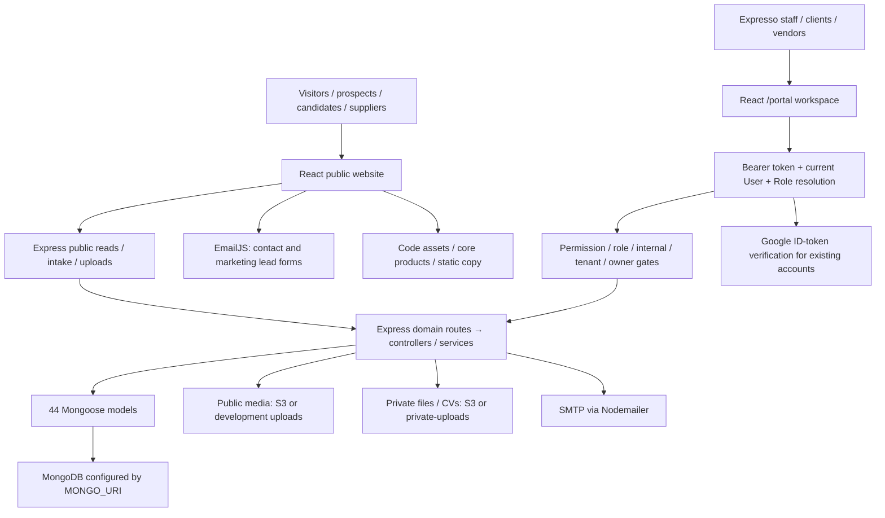
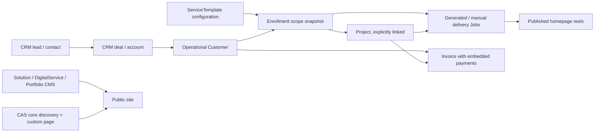

# System architecture

[Blueprint](EXPRESSO-SYSTEM-BLUEPRINT.html) · [Executive summary](README.md) · Baseline `58b8f86c`.

## Master request and data path

There is one React entry point (`client/src/index.js`), one top-level BrowserRouter (`client/src/App.js`), one Express app factory (`portal-api/src/app.js`) and one Mongoose connection (`portal-api/src/config/db.js`). No second frontend, independent portal database, microservice bus, payment service or CAS clinical database is implied by the route names.

## Public and portal sharing/isolation

| Concern | Shared | Isolated / restricted |
|---|---|---|
| Frontend bundle | React app, router, dependencies, origin; public links enter portal login | Portal lazy routes/layout and portal theme; public header/footer omitted on portal paths; `body[data-surface]` separates styles |
| Identity | Same User/Role system for staff, clients and vendors | Public marketing reads require no portal login; protected API requires verified Bearer token |
| Data | Same MongoDB connection; shared Customer, User, Media and published operational Job references | Tenant/owner/controller filters, role classification and permission gates; not separate physical databases |
| Website editing | Portal CMS writes feed public reads | `website.*` writes are internal; this does not automatically make every public read publication-safe |
| Uploads | Shared Multer/policy utilities and storage helpers | Public Media versus private File/CV/template attachments; visibility/authorization is a separate concern from storage location |
| Notifications | SMTP helper; Message unread counts in Topbar | EmailJS is a browser-to-provider contact path outside the API and CRM |
| Product pages | Existing CAS copy/images and one discovery registry | Registry supplies only discovery defaults; CMS enriches marketing metadata; full custom page remains separate |

## Frontend routing and API boundaries

- `App.js` mounts public pages and `/portal/*`, with Suspense and an error boundary. CAS legacy `/products/cas` redirects to `/digital-solutions/cas`.
- `PortalRoutes.jsx` defines login/reset/invite/access-request pages and the protected nested layout. Portfolio legacy portal paths redirect to `/portal/website/portfolio`.
- Public components use fetch or small Axios helpers with `REACT_APP_API_URL || /api`. Portal uses its Axios instance in `portal/shared/api/client.js`, adding Authorization and handling protected 401s.
- Portal navigation, ProtectedRoute and individual component checks are independent presentation layers. Backend middleware/controllers are the authority.
- SiteSettings has in-memory/storage caching plus update events; navigation caches successful CMS reads and shares in-flight requests. Portfolio hooks have another cache/error convention. These are not one unified data layer.

## API startup and request processing

`server.js` loads environment configuration, validates required secrets through `config/env.js`, connects MongoDB and starts `createApp()`. It does **not** bootstrap users, seed roles, install CMS content or run migrations.

Request order: Helmet/CORS → request logging → JSON body parsing → `/uploads` static public serving → health/auth throttles and mounted routers → controller/service logic → error middleware. Multipart routes add Multer/policy validation before storage. The default JSON body limit is 1 MB; upload routes define their own file limits.

Auth/reset/access/invite routes have in-memory rate limiting. There is no universal intake rate limiter on all public plan/vendor/CV routes in `app.js`. Deployment proxies/CORS are configured by environment, not proven by this code-only audit.

## Storage and integration map

| Integration | Source and consumers | Persisted side of the relationship | Important limit |
|---|---|---|---|
| MongoDB | `config/db.js`, all domain models | Accounts, business/config/CMS records, refs and file keys | A database backup is not an object backup; references are not enforced SQL foreign keys |
| Public S3 | `utils/s3.js`, Media uploads and image variants | Media URLs/keys/variants; CMS and creative refs | Public URL objects remain accessible independently of draft flags or database reset |
| Local public uploads | `uploads`, served by Express | Local bytes and public URLs in development fallback | Not a production private storage substitute |
| Private S3/local storage | `utils/privateStorage.js`; files, CVs, template attachments | File keys and legacy metadata; five-minute signed links | Requires authorization before link issuance; production fails closed for missing storage on new private uploads |
| Nodemailer/SMTP | `utils/email.js`; invites, password reset, optional RFQ publish | Invitation/reset state, RFQ publication; no durable email outbox | Missing SMTP does not guarantee a caller sees a delivery failure; RFQ notified count is attempted vendors, not delivery proof |
| Google sign-in | `iam/auth/auth.controller.js`; frontend Google OAuth | Existing User matched by verified email | Does not auto-create a user; configuration and external identity availability are outside MongoDB |
| EmailJS | ContactForm and LandingHero | No backend lead record in this path | Contact submission is not automatic CRM intake; separate from plan builder |
| Embedded maps/video/external media | ContactMap, UniqueServices/WebMarketing and CMS URLs | URL strings and optional Media metadata | Rendering those resources may need internet; the architecture blueprint itself does not |

Only environment variable **names**, defaults and usage sites were reviewed. Actual credentials, hosts, bucket names and SMTP addresses were not inspected or copied.

## Domain boundary distinctions

These arrows represent supported relationships, not automatic creation of every downstream record. See [user flows](USER-FLOWS.md) for explicit actions and missing automation. Counts, field refs and all endpoints are in the inventories; [public map](PUBLIC-WEBSITE-MAP.md) and [portal map](PORTAL-MODULE-MAP.md) are the page-level reading paths.
