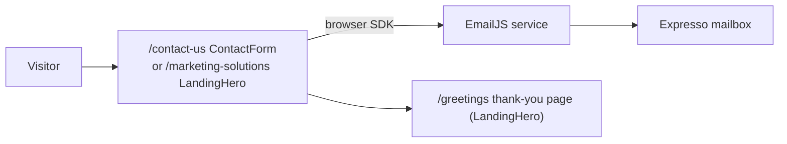
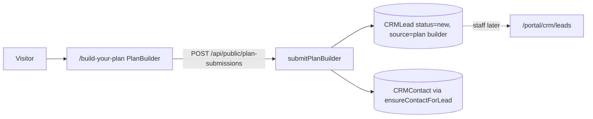
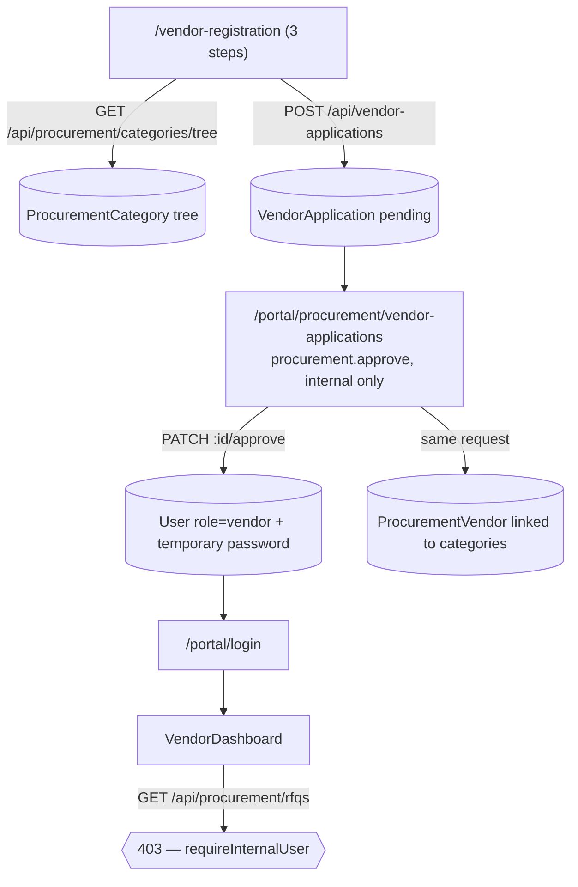
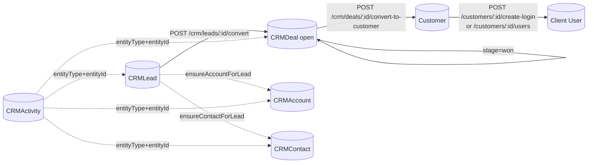
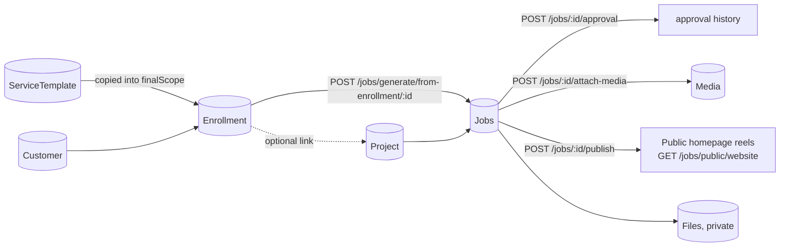
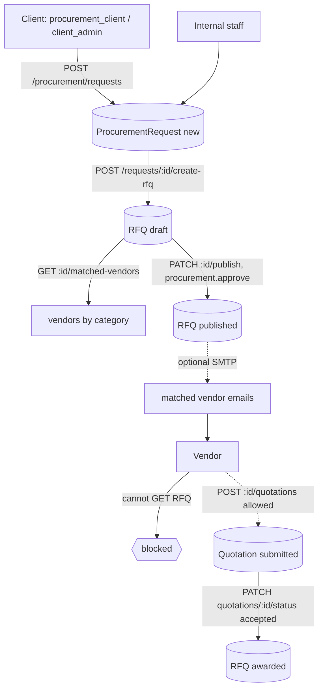
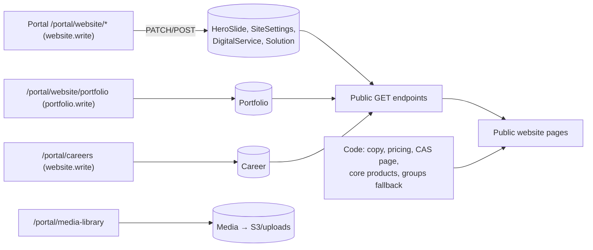

# User flows

[Blueprint](EXPRESSO-SYSTEM-BLUEPRINT.html) · [Executive summary](README.md) · Baseline `58b8f86c`.

These are the flows the source code actually implements at the baseline. Each step names the screen, the API call, the server check and the record that is written. Where a step a business owner might expect does not exist, it is marked **MISSING** rather than described as if it worked. Nothing was executed against a database to produce this map; it is read from routes, controllers and pages.

Status key: **COMPLETE** = every step exists end to end · **PARTIAL** = usable, with manual steps or gaps · **INCOMPLETE** = a step a user needs is blocked or missing.

| # | Flow | Status | One-line reason |
|---|---|---|---|
| 1 | Visitor → contact form | PARTIAL | Email reaches the inbox through EmailJS; nothing is recorded in CRM |
| 2 | Build Your Plan | PARTIAL | Creates a CRM lead and contact; no notification to staff, no confirmation email |
| 3 | Digital Solutions / CAS | COMPLETE (marketing) | Discovery, detail and demo CTA work; the demo request is the contact flow |
| 4 | Vendor registration → vendor portal | INCOMPLETE | Registration and approval work; an approved vendor cannot read RFQs |
| 5 | Portal authentication | COMPLETE | Password, Google (existing accounts), invite, reset, access request |
| 6 | Client / CRM | PARTIAL | Lead → deal → customer works; conversions are not transactional |
| 7 | Projects / delivery | PARTIAL | Enrollment → jobs → approvals → publish works; several links are manual |
| 8 | Invoicing / payments | PARTIAL | Manual invoices and payments; no sending, gateway or scheduler |
| 9 | Expenses | COMPLETE (manual) | Submit → approve → register → paid; receipts are URLs only |
| 10 | HR / leave | COMPLETE (manual) | Submit → approve/reject/cancel; no notifications |
| 11 | Procurement / RFQ | INCOMPLETE | Internal side works; the vendor side of quotations is blocked |
| 12 | Messaging / notifications | PARTIAL | Company threads plus 60-second unread polling; no email or push |
| 13 | CMS / publication | PARTIAL | Edits reach the site; unpublished records can still be read publicly |

---

## 1. Visitor → contact form — PARTIAL

1. The visitor fills `ContactForm` (`/contact-us`) or the landing form (`/marketing-solutions#lead-form`).
2. The browser sends the message straight to EmailJS with `@emailjs/browser`, using `REACT_APP_EMAILJS_*` keys. **The Expresso API is not called.**
3. The landing form redirects to `/greetings`.

**Not recorded:** there is no CRMLead, CRMContact or any other database record, and no rate limit inside Expresso. Someone must re-type an enquiry into CRM if it should be followed up there. The "Request a demo" button on CAS uses this same contact form (`/contact-us?interest=cas-demo`).

## 2. Build Your Plan — PARTIAL

1. The visitor chooses services and pricing presets (defined in code) and enters a name plus an email or phone.
2. `POST /api/public/plan-submissions` → `public.controller.js:submitPlanBuilder`. It requires no login and has no rate limiter.
3. A **CRMLead** is created with status `new` and no owner. `ensureContactForLead` creates or links a **CRMContact**.
4. Staff find it in `/portal/crm/leads` (`crm.read`).

**Missing:** no staff notification, no confirmation email to the visitor, no automatic owner assignment, no spam protection beyond field validation. It does not create a quote, project or invoice.

## 3. Digital Solutions / CAS — COMPLETE (marketing only)

1. Navigation and `/digital-solutions` merge the **core product registry in code** (`coreDigitalProducts.js` + `casProduct.js`) with published Solution records (`GET /api/web-content/solutions?kind=digital`).
2. CAS is always listed, even with an empty CMS or an API outage. A published CMS record only enriches its card.
3. `/digital-solutions/cas` renders the custom `CASPage` from code. `/products/cas` redirects there in the browser.
4. Other digital products render the shared Solution detail page from their CMS blocks.
5. The demo call-to-action leads to the contact flow (flow 1).

**Scope note:** this repository markets CAS. The CAS application itself (clinics, appointments, patients) and its database are not in this repository.

## 4. Vendor registration → vendor portal — INCOMPLETE

1. **Register (works).** The public form loads the 3-level category tree and posts a VendorApplication with status `pending`.
2. **Review (works).** Internal staff with `procurement.approve` list, open, approve or reject applications.
3. **Approve (works, with caveats).** Approval creates a vendor **User** with a generated temporary password, plus a **ProcurementVendor** profile. The password is returned to the approving staff member on screen. **It is not emailed**, and there is no forced password change at first login. User and vendor are created in two separate writes; a failure between them leaves partial state.
4. **Vendor login (works).** The vendor signs in at `/portal/login` and sees the vendor dashboard.
5. **See matched RFQs — BLOCKED.** Every RFQ read route uses `requireInternalUser`, so the dashboard's RFQ request is refused. `ProtectedRoute` also denies `/portal/procurement/rfqs` to external users. The controller has vendor-filtering code that is unreachable.
6. **Submit a quotation — unreachable in practice.** `POST /api/procurement/rfqs/:id/quotations` does accept the `vendor` role, but the vendor cannot open the RFQ to respond.

**Decision needed (not taken in this audit):** define what a vendor may see — published RFQs in their categories only — and then align route gates, controller filters and the UI denylist together.

**Status after Stage R2 (not yet deployed).** The steps above describe the audit baseline. In R2, approval no longer creates a user or a password: it creates the ProcurementVendor profile and emails an expiring, single-use invitation to the **Expresso Digital Vendor Portal**. The vendor sets their own password on `/portal/accept-invite`, which creates the vendor account and links it to the profile. Approved vendors (active profile with a linked account) can open published RFQs in their approved categories and submit quotations. Interrupted approvals and acceptances are completed by approving again or reopening the same link; see "P2-1 compensation limit (R2)" in [REMEDIATION-PLAN.md](REMEDIATION-PLAN.md).

## 5. Portal authentication — COMPLETE

| Path | Screen → API | What the server does |
|---|---|---|
| Password login | `/portal/login` → `POST /api/auth/login` (rate limited) | Verifies password hash and active flag, issues a JWT. Browser stores token, user and permission hints in localStorage |
| Google login | Google button → `POST /api/auth/google` (rate limited) | Verifies the Google ID token, then requires an **existing** active user with that email. No self-signup |
| Session check | Every portal load → `GET /api/auth/me` | Middleware reloads the User, rejects inactive users and tokens issued before the last password change, resolves current permissions |
| Forgot / reset | `/portal/forgot-password` → `POST /api/auth/forgot-password`; email link → `/portal/reset-password` → `POST /api/auth/reset-password` | Stores a hashed reset token, emails a 1-hour link via SMTP |
| Invitation | Staff `POST /api/invites` (`iam.invites.send`) → email → `/portal/accept-invite` → `GET /api/invites/verify`, `POST /api/invites/accept` | Invite valid 1–30 days (default 7). Accepting creates the User with the invited role/company. The role must exist (DB or built-in) and a named team must be an active Team |
| Access request | `/portal/request-access` → `POST /api/auth/request-access` | Creates an AccessRequest; staff approve/reject or convert it into an invite |
| Change password | `/portal/settings` → `PATCH /api/auth/change-password` | Checks the current password; sets `passwordChangedAt`, which invalidates older tokens |
| Admin actions | `/portal/users/:id` → force-logout, reset-password, status | `iam.users.write` plus the controller's role hierarchy |

Without SMTP configured, invite and reset emails cannot be delivered, and the caller is not guaranteed to see that failure.

## 6. Client / CRM — PARTIAL

1. Leads come from Build Your Plan or manual entry (`crm.write`).
2. **Convert lead → deal** creates or links an account and contact, creates an open deal, and marks the lead `converted`.
3. **Convert deal → customer** creates the account if missing, creates or updates the operational **Customer**, and marks the deal `won`.
4. Staff create client logins from the customer page. There are **two overlapping endpoints**, `create-login` and `POST /customers/:id/users`. Credentials are shown to the operator; no welcome email is sent.

**Conversions (R4-C):** each conversion runs in one database transaction (all or nothing) and repeating it returns the record already linked; without transaction support the API refuses with 503. `convertedDealId` is the lead → deal link; the legacy `convertedToDealId` is no longer written. **Gaps:** CRM activities record calls and tasks but send nothing.

## 7. Projects / delivery — PARTIAL

1. **Service catalog** (`/portal/services`, `services.*`) holds ServiceTemplates: scope groups, deliverables, pricing, SLA, attachments.
2. **Enrollment** (`/portal/enrollments`) links a customer to a template and stores a scope snapshot with overrides.
3. **Projects** (`/portal/projects`) can be customer, enrollment-linked or internal. Linking an enrollment and project is an explicit staff action.
4. **Jobs** are generated from an enrollment's scope, or created manually. They move through creative stages: brief → production → internal/client review → approved/scheduled → published/delivered.
5. **Approvals** are stored on the job. **Client review is not a client-facing workflow:** the `jobs.*` permissions are stripped from external users, so clients cannot open jobs.
6. **Publish to website** turns a job's media into a homepage reel.
7. **Production workspace** and **content calendar** are views over the same jobs.

**Gaps:** stage transitions are not enforced by one workflow engine. Creating an enrollment does not create a project or invoice. Create, update and delete do not check the company, so an external custom role granted `projects.write` or `projects.delete` could create, edit, move or delete another company's projects (see [RBAC](RBAC-MAP.md)). `DELETE /api/projects/:id` permanently deletes the project; archiving is a status change. **Since R3:** company checks were added in R1, and DELETE now archives the project (it leaves the default list; nothing linked is deleted).

## 8. Invoicing / payments — PARTIAL

1. Finance staff create an invoice (`POST /api/billing/invoices`, `billing.write`) for a customer, optionally linked to a project or enrollment. Numbers follow `INV-<year>-<sequence>`, computed as the last number that year + 1. The field is unique, so two invoices created at the same instant make the second fail with an error. **Since R3:** numbers come from an atomic per-year counter, so simultaneous creations all succeed with distinct numbers; a duplicate number typed by hand is refused with a clear message.
2. Statuses: `draft → sent → paid / overdue / void`. "Sent" is a status only — **no email or PDF is generated by the API.**
3. Payments are recorded manually and embedded in the invoice (`POST /:id/payments`; delete a payment). Amount paid and balance are recomputed when the invoice is saved. `mark-paid` and `void` are explicit actions.
4. `POST /invoices/mark-overdue` is a **button-driven** batch, not a scheduled job.
5. Clients have `billing.read` and see only their own company's invoices.

**Missing:** payment gateway, accounting ledger or export, a separate Payment collection, automatic overdue scheduling, invoice delivery. `billing.delete` exists in the catalog with no delete endpoint.

## 9. Expenses — COMPLETE (manual)

1. A staff member submits a claim at `/portal/hr/expenses` (`hr.expenses.write`). Self-service is limited to the user's own claims.
2. An approver (`hr.expenses.approve`, not the claimant — self-approval is refused) approves or rejects it.
3. Finance **registers** the claim against a month, then marks it **paid**.
4. `/portal/hr/monthly-expenses` summarises registered claims per month.

**Caveat:** a receipt is a URL or legacy Media reference, not a private uploaded receipt. No notifications are sent. Expenses are not posted to billing or accounting.

## 10. HR / leave — COMPLETE (manual)

1. An employee submits a request (`hr.leaves.write`) with type and dates. The leave belongs to the submitting user (`staffUserId`).
2. An approver (`hr.leaves.approve`) approves or rejects it; the requester can cancel.
3. KPI goals can derive values from leave, expense, scorecard and learning data (`autoSource`).

**Not present:** leave balances or accrual policy enforcement, calendar integration, email notifications, payroll.

## 11. Procurement / vendors / RFQ — INCOMPLETE

1. **Request:** a client or staff member raises a procurement request with a category.
2. **RFQ:** staff create an RFQ from the request (`procurement.write`) or directly. RFQ routes are internal-only.
3. **Match and publish:** vendors are matched by category ObjectIds. Publishing (`procurement.approve`) can email matched vendors through SMTP. The "notified" count means attempted, not delivered.
4. **Quote:** the vendor journey is blocked at reading the RFQ (see flow 4).
5. **Award:** staff accept a quotation, which marks the RFQ `awarded`. The procurement request's own status is updated separately by staff.

**Missing:** working vendor RFQ access, purchase orders, delivery and receipt tracking, any inventory. RFQ and quotation attachments are URL descriptors only.

## 12. Messaging / notifications — PARTIAL

1. Messages are organised **per customer company**: `GET/POST /api/messaging` (`messaging.read/write`). Any internal user with `messaging.read` can open any company's thread (there is no per-account-manager restriction); clients can open only their own company's thread.
2. Read state is a `readBy` list on each message (`PATCH /read/:customerId`).
3. The portal Topbar polls `GET /api/messaging/notifications/counts` **every 60 seconds** for unread badges.

**Not present:** a Notification collection, websocket or push, email-on-message, or a unified notification centre. The notification switches in `/portal/settings` are saved preferences; no code sends project, ticket or billing emails based on them.

## 13. CMS / publication — PARTIAL

1. Editors change slides, site settings and images, digital services, solutions (Type + Technology Group), portfolio items and vacancies in the portal.
2. Public pages read them through unauthenticated GET endpoints. Navigation and settings cache successful reads for the session, so changes can take a reload to appear.
3. **Publication boundary (gap):** `GET /api/portfolio?status=draft` and `GET /api/productions` return drafts if asked. `?includeInactive=1` on the web-content lists returns inactive records, and the slug detail endpoints do not check `isActive`. Hiding a record in the CMS therefore does **not** make it private.
4. Much of the copy (home, about, pricing, contact), the CAS page and the core product registry are code. Editing them needs a code change and deploy.
5. The sitemap is static. New CMS slugs are not added automatically.
